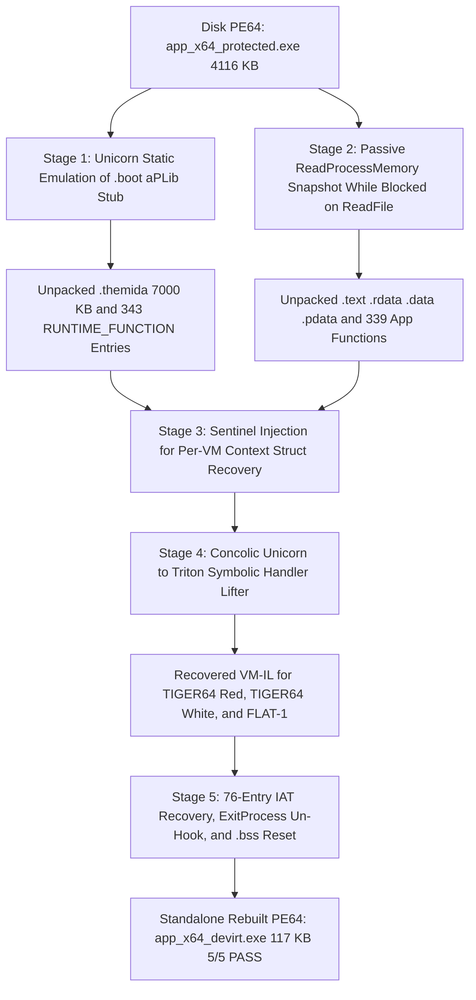
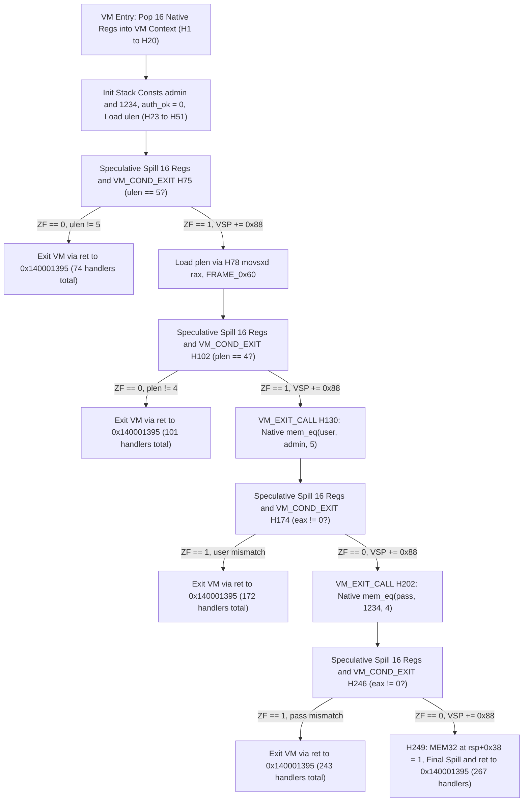

# Dissecting and Devirtualizing Themida x64 v3.2.4.52: Static `.boot` Unpacking, White-Box TIGER64 VM Internals, Concolic Triton Lifting, and Standalone PE64 Reconstruction

**Protected Input:** `app_x64_protected.exe` (`4,214,784 B`, PE32+ / AMD64, MSVC `14.44`, Oreans Themida x64 v3.2.4.52)--(https://github.com/est1mate/est1mate.github.io/tree/main/themida)
**Rebuilt Output:** `app_x64_devirt.exe` (`119,808 B`, `-97.16%`, `.themida` and `.boot` removed, standalone native Win64 executable)  

---

## Table of Contents

1. [Overview and Final Delta](#1-overview-and-final-delta)
2. [Static PE64 Triage and Multi-Signal Identification](#2-static-pe64-triage-and-multi-signal-identification)
3. [Stage-1 Unpacking: The `.boot` 12-Core aPLib Stub](#3-stage-1-unpacking-the-boot-12-core-aplib-stub)
4. [Stage-2 Unpacking: Passive Stdin-Blocked Memory Acquisition](#4-stage-2-unpacking-passive-stdin-blocked-memory-acquisition)
5. [White-Box TIGER64 VM Internals](#5-white-box-tiger64-vm-internals)
   - [5.1 Three-VM Assignment Across Macros](#51-three-vm-assignment-across-macros)
   - [5.2 Thread-Local Context Initialization (`gs:[0x30]`)](#52-thread-local-context-initialization-gs0x30)
   - [5.3 Per-VM Randomized `VM_CONTEXT` Structures](#53-per-vm-randomized-vm_context-structures)
   - [5.4 The 1,158-Entry Handler Trampoline Table and Dispatch](#54-the-1158-entry-handler-trampoline-table-and-dispatch)
   - [5.5 Fragmented Linked-List Bytecode and Rolling-Key Encryption (Worked Walkthrough)](#55-fragmented-linked-list-bytecode-and-rolling-key-encryption-worked-walkthrough)
   - [5.6 Polymorphic Handler Cloning and Red-Tier Junk Interleaving](#56-polymorphic-handler-cloning-and-red-tier-junk-interleaving)
   - [5.7 Speculative-Spill `VM_COND_EXIT` (`0x1401000D9`) — How TIGER64 Compiles `Jcc`](#57-speculative-spill-vm_cond_exit-0x1401000d9--how-tiger64-compiles-jcc)
6. [Automated Concolic Symbolic Lifting (Unicorn -> Triton)](#6-automated-concolic-symbolic-lifting-unicorn---triton)
   - [6.1 Per-Handler Concolic Slicing Architecture](#61-per-handler-concolic-slicing-architecture)
   - [6.2 Lifted Catalog and VM-IL Trace: `TIGER64 (Red)` OEP](#62-lifted-catalog-and-vm-il-trace-tiger64-red-oep)
   - [6.3 Lifted Catalog and VM-IL Trace: `TIGER64 (White)`](#63-lifted-catalog-and-vm-il-trace-tiger64-white)
7. [Deobfuscating `FLAT-1` (`0x1400445AB`) and Protection Tier Comparison](#7-deobfuscating-flat-1-0x1400445ab-and-protection-tier-comparison)
8. [IAT Recovery, CRT `.bss` Sanitization, and Standalone PE64 Reconstruction](#8-iat-recovery-crt-bss-sanitization-and-standalone-pe64-reconstruction)
   - [8.1 Recovering 76 `kernel32.dll` Imports and Un-Hooking `ExitProcess`](#81-recovering-76-kernel32dll-imports-and-un-hooking-exitprocess)
   - [8.2 Post-Dump CRT `.data` / `.bss` Crash Postmortem (`0x1400081EA`)](#82-post-dump-crt-data--bss-crash-postmortem-0x1400081ea)
   - [8.3 Re-Assembled Native x64 Patches](#83-re-assembled-native-x64-patches)
   - [8.4 Final PE64 Audit and Standalone Verification](#84-final-pe64-audit-and-standalone-verification)
9. [Extending the Pipeline to Harder Targets](#9-extending-the-pipeline-to-harder-targets)

---

## 1. Overview and Final Delta

Most public writeups on commercial virtualizers stop at black-box dynamic tracing: set a memory breakpoint on a stack buffer, dump a plaintext string, and close the case. That tells you what a single path wrote to memory, but it leaves the virtual machine's bytecode format, rolling-key state machine, handler dispatch mechanics, and control-flow lowering completely untouched—and leaves the binary tied to a 4 MB protector stub.

This study takes a self-authored PE64 offline-authentication testbed protected with **Oreans Themida x64 v3.2.4.52** all the way from packed disk image to a **working, standalone, protector-free PE64 binary**. The protection build log specifies the exact protection profile applied to the `109 KB` input binary:

- **Virtual Machines Generated:**
  - Machine #1: `TIGER64 (Red) VM` — `2,342 KB`
  - Machine #2: `TIGER64 (White) VM` — `1,139 KB`
  - Machine #3: `Internal (Lightning) VM` — `281 KB`
- **Unpaired Anti-Analysis Blocks (5):** `ANTI-1` (`0x1400011A2`, `1,473 B`, protection-state check), `ANTI-2` (`0x1400011B9`, `4,050 B`, debugger-presence check), `ANTI-3` (`0x1400011D0`, `2,482 B`, registration-state check), `ANTI-4` (`0x1400011E7`, `3,109 B`, code-integrity check), `ANTI-5` (`0x1400011FE`, `3,597 B`, virtual-PC check)
- **Paired Type I Blocks (2):** `STR-DEC` (`0x140001223–0x140001264`, delimited in-place string decryption), `FLAT-1` (`0x14000139F–0x1400013D4`, `1,436 B`, flattened/mutated region)
- **Paired Type II VM Blocks (2):** `TIGER64 (White)` (`0x1400012F8–0x140001395`, `3,932 B`), `TIGER64 (Red)` (`0x1400022B0–0x1400022C2`, `1,622 B`)
- **Compression:** Application/Resources `108 KB -> 56 KB (52%)`; SecureEngine `7,000 KB -> 4,055 KB (57%)`
- **Build Result:** `109 KB -> 4,116 KB`, `MD5: fc882de73478a72be5b8f728fdaad9e0`, elapsed `12s` on `12` cores

> **Label convention:** vendor macro identifiers are replaced with neutral analytic labels (`ANTI-1..ANTI-5`, `STR-DEC`, `FLAT-1`) in every section of this study. All addresses, byte sizes and behavioral findings are those observed in the target and are unchanged by the substitution.

We never attach a live debugger to the protected binary and never patch anti-debug checks in memory. Instead, each layer is isolated to its minimum execution surface:



Before-and-after metrics on the protected input versus the rebuilt output:

| Metric | `app_x64_protected.exe` | `app_x64_devirt.exe` |
| :--- | :--- | :--- |
| File Size | `4,214,784 B` (`4,116.0 KB`) | `119,808 B` (`117.0 KB`, `-97.16%`) |
| Whole-File Shannon Entropy | `7.9600` | `5.6871` |
| `SizeOfImage` | `0xAED000` (`10.93 MB`) | `0x20000` (`128 KB`) |
| Section Count | `9` (`.themida` + `.boot` present) | `7` (protector completely stripped) |
| Entry Point VA | `0x1406F6058` (`.boot` aPLib stub) | `0x1400022B0` (`mainCRTStartup` OEP) |
| Static Imports | `1` (`kernel32.dll!GetModuleHandleA`) | `76` (`kernel32.dll`, `ExitProcess` un-hooked) |
| PE Checksum Valid | `True` (`0x411AF7`) | `True` |
| MD5 | `fc882de73478a72be5b8f728fdaad9e0` | `dd03a0bc3747491ce5c116c21b862998` |
| SHA256 | `d2a0630c941d19d7cecd9de0f6e8087d271752e29a76e0bcce2e33327094cdfb` | `b0b7ee5da6e59cff7f960c23a3527a630b2dd1e3f4d902c1f744c8fed1e36339` |
| Live Windows Verification | `4/4 PASS` | `5/5 PASS` (zero `.themida` code) |

---

## 2. Static PE64 Triage and Multi-Signal Identification

Static PE64 triage on `app_x64_protected.exe` establishes the container geometry. Detect It Easy (`die-python 0.5.0`, deep scan) returns `PE64 / Unknown: Unknown` because Themida `3.2.4.52` is newer than its signature database. Never rely on signature scanners or section names (`.themida` is trivial to spoof); four independent structural signals confirm Themida 3.x:

1. **PE64 Headers & Mitigations:**
   - `Machine = 0x8664` (AMD64), `Magic = 0x20B` (PE32+), `LinkerVersion = 14.44` (Visual Studio 2022), `Subsystem = 3` (`WINDOWS_CUI`), `Rich Header` preserved (`checksum = 0x285c48d5`, `22` entries).
   - `ImageBase = 0x140000000`, `AddressOfEntryPoint = 0x6F6058` (`VA 0x1406F6058`, inside `.boot`), `SizeOfImage = 0xAED000`, `SizeOfHeaders = 0x400`, zero overlay bytes.
   - `DllCharacteristics = 0x8020`: `HIGH_ENTROPY_VA = True`, `TERMINAL_SERVER_AWARE = True`, while **`DYNAMIC_BASE (ASLR) = False`**, **`NX_COMPAT (DEP) = False`**, and **`GUARD_CF = False`**. With ASLR disabled, the loader maps the image at `0x140000000` deterministically, so runtime VAs match build manifest addresses directly.

2. **Section Table and Disk-vs-Live Entropy Profile:**

| Idx | Name | RVA | VirtualSize | RawOffset | RawSize | Perms | Disk Ent | Live Ent | Interpretation |
| :-: | :--- | :--- | ---: | ---: | ---: | :-: | :-: | :-: | :--- |
| 0 | *(spaces)* | `0x1000` | `0xEE50` (`61,008 B`) | `0x400` | `0x9400` (`37,888 B`) | `R-X` | `7.9575` | `6.4719` | Compressed original `.text` (`RawSize < VSize`) |
| 1 | *(spaces)* | `0x10000` | `0x98FE` (`39,166 B`) | `0x9800` | `0x4000` (`16,384 B`) | `R--` | `7.8898` | `4.5594` | Compressed original `.rdata` + IAT |
| 2 | *(spaces)* | `0x1A000` | `0x1B50` (`6,992 B`) | `0xD800` | `0x200` (`512 B`) | `RW-` | `6.4955` | `1.7632` | Compressed original `.data` + `.bss` |
| 3 | *(spaces)* | `0x1C000` | `0xFE4` (`4,068 B`) | `0xDA00` | `0xA00` (`2,560 B`) | `R--` | `7.2674` | `4.8823` | Compressed original `.pdata` (`339` functions) |
| 4 | *(spaces)* | `0x1D000` | `0x100` (`256 B`) | `0xE400` | `0x200` (`512 B`) | `RW-` | `0.1019` | `0.6238` | Small RW section (`_RDATA`) |
| 5 | *(spaces)* | `0x1E000` | `0x660` (`1,632 B`) | `0xE600` | `0x600` (`1,536 B`) | `R--` | `6.8209` | `5.3961` | Small RO section |
| 6 | `.idata` | `0x1F000` | `0x1000` (`4,096 B`) | `0xEC00` | `0x200` (`512 B`) | `RW-` | `0.6496` | `0.1159` | Stub Import Table (`GetModuleHandleA` only) |
| 7 | `.themida` | `0x20000` | `0x6D6000` (`7,000 KB`) | `0xEE00` | `0x0` (`0 B`) | `RWX` | `0.0000` | `6.0408` | Virtual-only landing zone for SecureEngine |
| 8 | `.boot` | `0x6F6000` | `0x3F6200` (`4,056.5 KB`) | `0xEE00` | `0x3F6200` | `R-X` | `7.9601` | `7.9601` | Entry Point + 12-chunk compressed SecureEngine |

3. **Data Directories & Strings:** Only two Data Directories are populated:
   - `IMAGE_DIRECTORY_ENTRY_IMPORT`: `RVA 0x1F020`, `Size 0x40` (`.idata`) — imports a single symbol, `kernel32.dll!GetModuleHandleA`. Zero exports, zero TLS callbacks, zero resources.
   - `IMAGE_DIRECTORY_ENTRY_EXCEPTION`: `RVA 0x6C1AD8`, `Size 0x1014` (inside virtual-only `.themida`, zeroed on disk).
   - Scanning all 4.1 MB for ASCII and UTF-16LE strings returns only `kernel32.dll` in `.idata`; every application string is compressed inside Section 0–1.

4. **On-Disk Macro Verification:** Reading raw bytes at every manifest macro VA (`0x1400011A2`, `0x1400011B9`, ..., `0x1400022B0`) yields random compressed ciphertext (`1eddba3a31f79f88...` at `0x1400011A2`, `b06d93ead78d6f6a...` at `0x1400022B0`), confirming that static disassembly of Section 0 before unpacking is pointless.

---

## 3. Stage-1 Unpacking: The `.boot` 12-Core aPLib Stub

Disassembling `0x1406F6058` shows that Stage 1 is a completely self-contained x64 decompression driver with zero Win32 API calls:

```nasm
; --- Entry Point (0x1406F6058) ---
0x1406F6058: e8 82 01 00 00        call  0x1406F61DF    ; pushes RAX = 0x1406F605D (aPLib depacker)

; --- Inline x64 aPLib Depacker (0x1406F605D .. 0x1406F61DE) ---
0x1406F605D: 41 52                 push  r10
0x1406F605F: 49 89 e2              mov   r10, rsp
0x1406F6062: 41 52                 push  r10
0x1406F6064: 49 8b 72 10           mov   rsi, qword ptr [r10 + 0x10] ; src ptr
0x1406F6068: 49 8b 7a 20           mov   rdi, qword ptr [r10 + 0x20] ; dst ptr
0x1406F606C: fc                    cld
0x1406F606D: b2 80                 mov   dl, 0x80       ; aPLib bit-tag sentinel
0x1406F606F: 8a 06                 mov   al, byte ptr [rsi]
0x1406F6071: 48 ff c6              inc   rsi
0x1406F6074: 88 07                 mov   byte ptr [rdi], al
0x1406F6076: 48 ff c7              inc   rdi
0x1406F6079: bb 02 00 00 00        mov   ebx, 2         ; LWM = 2
0x1406F607E: 00 d2                 add   dl, dl         ; shift next tag bit into CF
0x1406F6080: 75 07                 jne   0x1406F6089
0x1406F6082: 8a 16                 mov   dl, byte ptr [rsi]
0x1406F6084: 48 ff c6              inc   rsi
0x1406F6087: 10 d2                 adc   dl, dl
0x1406F6089: 73 e4                 jae   0x1406F606F    ; bit=0 -> literal byte copy
...

; --- Multi-Chunk Unpack Driver (0x1406F61DF .. 0x1406F6246) ---
0x1406F61DF: 58                    pop   rax            ; rax = 0x1406F605D (aPLib entry)
0x1406F61E0: 53 51 52 56 57 55     push  rbx, rcx, rdx, rsi, rdi, rbp
0x1406F61E6: 48 89 c3              mov   rbx, rax
0x1406F61E9: 48 83 eb 05           sub   rbx, 5         ; rbx = 0x1406F6058
0x1406F61ED: b9 58 60 6d 00        mov   ecx, 0x6D6058
0x1406F61F2: 48 29 cb              sub   rbx, rcx       ; rbx = 0x140020000 (.themida base!)
0x1406F61F5: 50                    push  rax
0x1406F61F6: b8 cc 0f 30 00        mov   eax, 0x300FCC
0x1406F61FB: 48 01 d8              add   rax, rbx       ; rax = 0x140320FCC (SecureEngine EP)
0x1406F61FE: 83 38 00              cmp   dword ptr [rax], 0 ; already unpacked?
0x1406F6201: 74 03                 je    0x1406F6206
0x1406F6203: 58                    pop   rax
0x1406F6204: eb 32                 jmp   0x1406F6238
0x1406F6206: 58                    pop   rax
0x1406F6207: b9 f0 01 00 00        mov   ecx, 0x1F0
0x1406F620C: 83 e9 05              sub   ecx, 5
0x1406F620F: 48 01 c1              add   rcx, rax       ; rcx = 0x1406F6248 (compressed payload)
0x1406F6212: 53                    push  rbx
0x1406F6213: 48 89 ce              mov   rsi, rcx       ; rsi = 0x1406F6248
0x1406F6216: 48 89 df              mov   rdi, rbx       ; rdi = 0x140020000
0x1406F6219: 8a 0e                 mov   cl, byte ptr [rsi] ; cl = 0x0C (12 chunks!)
0x1406F621B: 48 ff c6              inc   rsi            ; rsi = 0x1406F6249 (Chunk 1 start)
0x1406F621E: 84 c9                 test  cl, cl
0x1406F6220: 74 15                 je    0x1406F6237
0x1406F6222: 51 50 57 6a 00 57 6a 00 56 ; push saved regs + (dst=rdi, src=rsi)
0x1406F622B: ff d0                 call  rax            ; rax = aP_depack(rsi, rdi) -> out_len
0x1406F622D: 5f                    pop   rdi
0x1406F622E: 48 01 c7              add   rdi, rax       ; advance destination by decompressed size
0x1406F6231: 58 59                 pop   rax ; pop rcx
0x1406F6233: fe c9                 dec   cl
0x1406F6235: eb e7                 jmp   0x1406F621E
0x1406F6237: 5b                    pop   rbx
0x1406F6238: b8 cc 0f 30 00        mov   eax, 0x300FCC
0x1406F623D: 48 01 d8              add   rax, rbx       ; rax = 0x140320FCC
0x1406F6240: 5d 5f 5e 5a 59 5b     pop   rbp, rdi, rsi, rdx, rcx, rbx
0x1406F6246: ff e0                 jmp   rax            ; handoff to SecureEngine!
```

Emulating `0x1406F6058 -> 0x1406F6246` in Unicorn unpacks `.themida` completely offline without touching Windows. Hooking `0x1406F622B` and `0x1406F622D` captures all 12 chunks:

| Chunk | Compressed `src` VA | Compressed Size | Unpacked `dst` VA | Unpacked Size | Ratio | Contents Profile |
| :-: | :--- | ---: | :--- | ---: | :-: | :--- |
| 1 | `0x1406F6249` | `325,145 B` | `0x140020000` | `597,333 B` | `54.4%` | SecureEngine init + TIGER64 Red start |
| 2 | `0x140745862` | `306,701 B` | `0x1400B1D55` | `597,333 B` | `51.3%` | `TIGER64 (Red)` VM handlers |
| 3 | `0x14079066F` | `306,861 B` | `0x140143AAA` | `597,333 B` | `51.4%` | `TIGER64 (Red)` VM handlers |
| 4 | `0x1407DB51C` | `304,978 B` | `0x1401D57FF` | `597,333 B` | `51.1%` | `TIGER64 (Red)` VM handlers |
| 5 | `0x140825C6E` | `313,761 B` | `0x140267554` | `597,333 B` | `52.5%` | `TIGER64 (Red)` tail + `TIGER64 (White)` start |
| 6 | `0x14087260F` | `299,424 B` | `0x1402F92A9` | `597,333 B` | `50.1%` | `TIGER64 (White)` VM handlers (`0x140320FCC` EP) |
| 7 | `0x1408BB7AF` | `308,817 B` | `0x14038AFFE` | `597,333 B` | `51.7%` | `TIGER64 (White)` handlers + handler table (`0x140435C29`) |
| 8 | `0x140906E00` | `291,217 B` | `0x14041CD53` | `597,333 B` | `48.8%` | Handler tables + sparse metadata |
| 9 | `0x14094DF91` | `402,591 B` | `0x1404AEAA8` | `597,333 B` | `67.4%` | Mutated code + SecureEngine loader |
| 10 | `0x1409B0430` | `396,357 B` | `0x1405407FD` | `597,333 B` | `66.4%` | SecureEngine loader + `ANTI-*` code |
| 11 | `0x140A11075` | `412,374 B` | `0x1405D2552` | `597,333 B` | `69.0%` | SecureEngine loader + `ANTI-*` code |
| 12 | `0x140A75B4B` | `484,588 B` | `0x1406642A7` | `597,337 B` | `81.1%` | **Encrypted VM bytecode pools** (`0x1406A1...`, `0x1406EC...`) + `.pdata` |
| **Total** | | **`4,152,814 B`** | | **`7,168,000 B`** | **`57.94%`** | **Exact match to manifest (`7,000 KB`)** |

Notice two forensic details in that table:
1. Themida slices `7,168,000 B` evenly across the build machine's 12 CPU cores (`597,333 B x 11 + 597,337 B = 7,168,000 B`) to compress SecureEngine in parallel—matching `Elapsed Time: 12 seconds (using 12 cores)` in the build log.
2. The per-chunk compression ratio acts as a free structural X-ray: Chunks 1–8 (`48.8%–54.4%`) contain highly repetitive VM handler code (`TIGER64 Red` and `TIGER64 White`), whereas Chunk 12 spikes to **`81.1%`** because it houses the rolling-key-encrypted bytecode pools (`0x1406A1600..0x1406A1C60` for Red, `0x1406EC777..0x1406ED6C5` for White).

The unpacked `.themida` dump (`themida_unpacked.bin`, `MD5: 9f000aeb68dadd02730db9c61186b9e8`, `5,377,947` non-zero bytes, entropy `6.0374`) also materializes all `343` `RUNTIME_FUNCTION` entries in `IMAGE_DIRECTORY_ENTRY_EXCEPTION` (`0x1406C1AD8`) and reveals Oreans internal strings (`Software\WinLicense`, `WinLicenseInstance`, `WinLicenseDriverVersion`, `Exception Information`).

---

## 4. Stage-2 Unpacking: Passive Stdin-Blocked Memory Acquisition

Executing `app_x64_protected.exe` cleanly with dummy input (`AAAA-BBBB-CCCC-DDDD\n`) returns `U: P: ERR\n` in `0.104s` (`rc = 0`). Rather than fighting `ANTI-2` or `ANTI-4` with debugger hiding plugins or Frida inline hooks, we exploit the program's own blocking I/O:

1. A host harness spawns `app_x64_protected.exe` with an open `stdin` pipe (`subprocess.Popen(..., stdin=PIPE)`).
2. Unmodified SecureEngine runs to completion: it unpacks Sections 0–5 in place, resolves the IAT, executes all five `ANTI-*` blocks cleanly, decrypts `STR-DEC`, prints `U: `, and blocks inside `kernel32!ReadFile`.
3. After `500 ms`, the reader opens the PID with `OpenProcess(PROCESS_VM_READ | PROCESS_QUERY_INFORMATION)` and reads all `11,456,512` bytes of `0x140000000..0x140AED000` page-by-page (`4 KB` chunks), then feeds dummy stdin so the process exits cleanly with `rc = 0`.

Zero debugger attached, zero `INT3` traps, zero page-guard modifications. Section entropy drops immediately across Sections 0–3 (`.text` `7.96 -> 6.47`, `.rdata` `7.89 -> 4.56`, `.data` `6.50 -> 1.76`, `.pdata` `7.27 -> 4.88`).

### Recovered Application Functions and `run_auth()` Stack Layout

Parsing the unpacked `.pdata` (`0x14001C000`, `0xFE4` bytes) yields `339` `RUNTIME_FUNCTION` entries. Everything outside MSVC CRT boilerplate reduces to five user functions plus the virtualized CRT entry point:

| VA Range | Size | Recovered Signature / Role |
| :--- | ---: | :--- |
| `0x140001000 – 0x14000105B` | `91 B` | `int mem_eq(const char *a, const char *b, int len)` — byte loop, returns `1` or `0` |
| `0x140001070 – 0x1400010B4` | `68 B` | `void write_str(HANDLE hOut, const char *buf, int len)` — wraps `WriteFile` (`[0x140010010]`) |
| `0x1400010C0 – 0x140001162` | `162 B` | `int read_line(HANDLE hIn, char *buf, int maxLen)` — 1-byte `ReadFile` (`[0x140010008]`) loop; skips `\r`, stops on `\n` |
| `0x140001170 – 0x140001469` | `761 B` | `void run_auth(void)` — contains Macros #1–#8, console I/O, and trailing 32-byte buffer zeroing |
| `0x140001470 – 0x140001480` | `16 B` | `int main(void)` — `call 0x140001170; xor eax, eax; ret` |
| `0x1400022B0 – 0x1400022C2` | `18 B` | `mainCRTStartup` (OEP) — Macro #9 (`TIGER64 Red`, `jmp 0x1406C975E`) |

Disassembling `run_auth()` (`0x140001170`, `sub rsp, 0xD0`) maps its exact stack frame:

```text
run_auth() Stack Frame (sub rsp, 0xD0; frame base = RSP at 0x140001179)
+--------+--------+-------------------------------------------------------------------+
| Offset | Size   | Role / Proven Usage                                               |
+--------+--------+-------------------------------------------------------------------+
| +0x20  |  4 B   | Loop index `i` (0..31) for trailing buffer wipe (0x1400013DE)     |
| +0x24  |  3 B   | "U: "   (55 3a 20) — decrypted in-place by STR-DEC (#6)           |
| +0x28  |  3 B   | "P: "   (50 3a 20) — decrypted in-place by STR-DEC (#6)           |
| +0x2C  |  3 B   | "OK\n"  (4f 4b 0a) — decrypted in-place by STR-DEC (#6)           |
| +0x30  |  4 B   | expected_pass[4] ("1234") — written at runtime by TIGER64 White   |
| +0x34  |  4 B   | "ERR\n" (45 52 52 0a) — decrypted in-place by STR-DEC (#6)        |
| +0x38  |  4 B   | auth_ok (0 or 1) — written by TIGER64 White, read by FLAT-1 (#7)  |
| +0x40  |  8 B   | hOut = GetStdHandle(STD_OUTPUT_HANDLE = -11)                      |
| +0x48  | 20 B   | 5x DWORD output vars for ANTI-1..ANTI-5                           |
| +0x5C  |  4 B   | ulen = read_line(hIn, user, 32)                                   |
| +0x60  |  4 B   | plen = read_line(hIn, pass, 32)                                   |
| +0x68  |  8 B   | hIn = GetStdHandle(STD_INPUT_HANDLE = -10)                        |
| +0x80  |  5 B   | expected_user[5] ("admin") — written at runtime by TIGER64 White  |
| +0x88  | 32 B   | char user[32] (zeroed via rep stosb, read via read_line)          |
| +0xA8  | 32 B   | char pass[32] (zeroed via rep stosb, read via read_line)          |
| +0xC8  |  8 B   | __security_cookie ^ RSP                                           |
+--------+--------+-------------------------------------------------------------------+
```

Because the `STR-DEC` pair (`0x14000121E..0x140001264`) executed before the process blocked on `ReadFile`, the live dump captures its 65-byte body already decrypted in `.text` (13 consecutive `mov byte ptr [rsp + off], imm8` instructions initializing `"U: "`, `"P: "`, `"OK\n"`, and `"ERR\n"` directly on the stack).

---

## 5. White-Box TIGER64 VM Internals

### 5.1. Three-VM Assignment Across Macros

Oreans' TIGER family is a register/stack hybrid RISC-style VM parameterized by obfuscation tier (`White` prioritizes execution speed; `Red` increases handler bloat and junk density; `Black` maximizes complexity), while `Internal (Lightning)` powers SecureEngine's loader/API-wrapping subsystem.

Emulating the entry trampoline of every macro for 3,000 steps in Unicorn and recording `RBP` at indirect jumps maps the exact VM assignment in this build:

| Macro # | Macro Type | `.text` Entry | `.themida` Chain | Executing VM Engine | Context `RBP` |
| :-: | :--- | :--- | :--- | :--- | :--- |
| #1 | `ANTI-1` | `0x14000119D` | `0x14007F1C8 -> 0x1403CD51A -> 0x140670E99` | `TIGER64 (Red)` | `0x140033C48` |
| #2 | `ANTI-2` | `0x1400011B4` | `0x14007F1CD -> 0x14004713F -> 0x1406AE58D` | `TIGER64 (Red)` | `0x140033C48` |
| #3 | `ANTI-3` | `0x1400011CB` | `0x1403BE6FC -> 0x140185883 -> 0x1406A0093` | `TIGER64 (Red)` | `0x140033C48` |
| #4 | `ANTI-4` | `0x1400011E2` | `0x1403BE701 -> 0x1404246C2 -> 0x1405B52D0` | `TIGER64 (Red)` | `0x140033C48` |
| #5 | `ANTI-5` | `0x1400011F9` | `0x1402012AA -> 0x140032520 -> 0x1406B142B` | `TIGER64 (Red)` | `0x140033C48` |
| #6 | `STR-DEC` (end) | `0x140001264` | `0x1402012AF -> 0x14044CFD2 -> 0x140693B93` | `TIGER64 (Red)` | `0x140033C48` |
| #7 | `FLAT-1` | `0x14000139A` | `0x1400445AB -> 0x14033E2B4 -> 0x1404540D4` | Flat Mutated x64 | None |
| #8 | `TIGER64 (White)` | `0x1400012F3` | `0x1406F3AAE` | `TIGER64 (White)` | `0x1402DFFA2` |
| #9 | `TIGER64 (Red)` (OEP) | `0x1400022B0` | `0x1406C975E` | `TIGER64 (Red)` | `0x140033C48` |
| — | SecureEngine Loader | `0x140320FCC` | `.boot` handoff target | `Internal (Lightning)` | Internal |

All five `ANTI-*` blocks and the `STR-DEC` boundary share the exact same `TIGER64 (Red)` instance (`0x140033C48`) as OEP (`mainCRTStartup`).

### 5.2. Thread-Local Context Initialization (`gs:[0x30]`)

Attempting to emulate `TIGER64 (White)` (`0x1406F3AAE`) in a bare Unicorn x64 context fails at instruction `477` (`0x1404621B6`) with `UC_ERR_READ_UNMAPPED` on address `0x30`:

```nasm
0x1404621B6: 65 48 a1 30 00 00 00 00 00 00 00   movabs rax, qword ptr gs:[0x30] ; TEB.NtTib.Self
0x1404621C1: 48 39 f5                           cmp    rbp, rsi                 ; 0x1402DFFA2
0x1404621C4: 0f 85 92 01 00 00                  jne    0x14046235C
0x1404621CA: 48 c1 e0 20                        shl    rax, 0x20
```

At this point `RBP = RSI = 0x1402DFFA2` and `R9 = 0x12F8` (the exact RVA of Macro #8). Themida hashes `TEB.NtTib.Self` to acquire a thread-safe VM context entry and increments a lock reference counter at `[RBP + 0xE7]` (released via `lock sub dword ptr [rbp + 0xE7], 1` on VM exit). Mapping a 16 KB synthetic TEB/PEB region at `0x7FF00000` (`TEB+0x08 = StackBase`, `TEB+0x10 = StackLimit`, `TEB+0x30 = 0x7FF00000`, `TEB+0x48 = 0x1234`, `TEB+0x60 = 0x7FF02000`) and setting `UC_X86_REG_GS_BASE = 0x7FF00000` resolves the prologue for both `TIGER64 (White)` and `TIGER64 (Red)` with zero Win32 API emulation needed.

### 5.3. Per-VM Randomized `VM_CONTEXT` Structures

Both TIGER64 engines anchor their `VM_CONTEXT` structure in `RBP`, but Themida **independently randomizes every struct offset per generated VM**. To recover both layouts automatically, we load 15 distinct 64-bit magic sentinels (`RAX = 0x1111111111110001` .. `R15 = 0xFFFFFFFFFFFF000F`) into all non-RSP GPRs before VM entry and record every 8-byte write into `[RBP .. RBP + 0x200]`. Every native GPR slot maps cleanly on the first pass; frequency/monotonicity analysis identifies `VIP`, `VSP`, rolling keys, and handler-table pointers:

```c
// Exact recovered VM_CONTEXT for TIGER64 (White) — pinned at RBP = 0x1402DFFA2
struct tiger64_white_ctx {
    uint32_t scratch_00;              // +0x000  (R=64, W=35)
    uint64_t handler_table_base;      // +0x004  = 0x140435C29 (1,158 relocated handler offsets)
    uint32_t rolling_handler_key;     // +0x01D  (R=397, W=269; bit 0 used by Clone C parity branch)
    uint64_t ea_scratch_ptr;          // +0x029  (effective address / frame pointer scratch, e.g. 0x30005C)
    uint16_t decoded_dst_slot;        // +0x031  (R=438, W=222; decoded 16-bit target vReg offset)
    uint64_t image_base;              // +0x037  = 0x140000000 (added to exit RVAs in VM_COND_EXIT)
    uint32_t key_modifier_a;          // +0x03F  (operand #1 decryption addend, e.g. 0x224460C8)
    uint64_t vR8;                     // +0x057  (native R8 save slot)
    uint64_t vR15;                    // +0x05F  (native R15 save slot)
    uint64_t next_handler_va;         // +0x067  (pre-resolved trampoline VA from handler_table[idx])
    uint64_t VSP;                     // +0x06F  (R=196, W=182; Virtual Stack Pointer)
    uint64_t VIP;                     // +0x08F  (R=1910, W=278; start = 0x1406EC8EB)
    uint64_t vR13;                    // +0x09F  (native R13 save slot)
    uint64_t vRDX;                    // +0x0A7  (native RDX save slot)
    uint64_t vR14;                    // +0x0AF  (native R14 save slot)
    uint8_t  vm_state_byte;           // +0x0B7  (R=304, W=88)
    uint64_t vR11;                    // +0x0C2  (native R11 save slot)
    uint8_t  cond_exit_flag;          // +0x0DE  (cleared to 0 at VM_COND_EXIT entry)
    uint32_t rolling_bytecode_key;    // +0x0DF  (R=1101, W=300; primary feedback stream key K_df)
    uint32_t key_modifier_b;          // +0x0E3  (R=190, W=3; operand #2 key addend / XOR mask)
    uint32_t vm_lock_refcount;        // +0x0E7  (decremented via `lock sub` on VM exit)
    uint16_t decoded_src_slot;        // +0x0FE  (masked src offset; unmasked via xor 0xDE48)
    uint64_t vRBP;                    // +0x100  (native RBP save slot)
    uint64_t vR12;                    // +0x10E  (native R12 save slot)
    uint64_t vRDI;                    // +0x120  (native RDI save slot)
    uint64_t vRBX;                    // +0x128  (native RBX save slot)
    uint64_t vR10;                    // +0x130  (native R10 save slot)
    uint64_t vR9;                     // +0x142  (native R9 save slot)
    uint64_t vRSI;                    // +0x152  (native RSI save slot)
    uint64_t vRCX;                    // +0x15E  (native RCX save slot)
    uint64_t vRAX;                    // +0x166  (native RAX save slot)
    uint32_t vRFLAGS;                 // +0x174  (virtual RFLAGS tested by VM_COND_EXIT)
};

// Exact recovered VM_CONTEXT for TIGER64 (Red) — pinned at RBP = 0x140033C48
struct tiger64_red_ctx {
    uint16_t decoded_slot_or_op;      // +0x053  (R=134, W=69)
    uint64_t vR9;                     // +0x055
    uint64_t vR12;                    // +0x069
    uint64_t vRAX;                    // +0x071
    uint64_t vR8;                     // +0x079
    uint64_t vRBP;                    // +0x085
    uint64_t vR15;                    // +0x09F
    uint64_t vRSI;                    // +0x0A8
    uint32_t rolling_bytecode_key;    // +0x0B2  (R=410, W=192)
    uint64_t vR14;                    // +0x0B6
    uint64_t vR11;                    // +0x0CC
    uint64_t vRBX;                    // +0x0D8
    uint64_t VSP;                     // +0x0E2  (R=75, W=75)
    uint32_t rolling_handler_key;     // +0x0F7  (R=168, W=130)
    uint64_t VIP;                     // +0x11F  (R=639, W=90; start = 0x1406A19C1)
    uint64_t vR13;                    // +0x127
    uint64_t vRDX;                    // +0x130
    uint64_t vRCX;                    // +0x140
    uint64_t handler_table_base;      // +0x15C  = 0x1403018C2
    uint64_t vR10;                    // +0x16C
    uint64_t vRDI;                    // +0x174
};
```

Not a single offset matches between `tiger64_white_ctx` and `tiger64_red_ctx`. Sentinel injection makes context discovery completely immune to this randomization—any new Themida 3.x build yields its full 15-register map in a single Unicorn run.

### 5.4. The 1,158-Entry Handler Trampoline Table and Dispatch

During `TIGER64 (White)` startup (`0x1404626A7`), the VM iterates over **`1,158` consecutive 64-bit offsets** starting at `0x140435C29` (`ctx.handler_table_base`):

```text
0x140435C29 [+0x00]: 0x00000000000566DF
0x140435C31 [+0x08]: 0x00000000000893BE   \__ +5 byte pair (E9 rel32 trampoline table!)
0x140435C39 [+0x10]: 0x00000000000893C3   /
0x140435C41 [+0x18]: 0x00000000000909F8   \__ +5 byte pair
0x140435C49 [+0x20]: 0x00000000000909FD   /
0x140435C51 [+0x28]: 0x00000000000AE2A4   \__ +5 byte pair
0x140435C59 [+0x30]: 0x00000000000AE2A9   /
```

Every handler is fronted by a 5-byte `E9 rel32` jump stub inside `.themida` (e.g., `0x140040741: jmp 0x1403FB9CE`, `0x140040EFD: jmp 0x14037A0DF`). On VM initialization, Themida relocates this table in place, and at runtime each handler pre-resolves the next handler's VA into `ctx.next_handler_va` (`[RBP + 0x67]`) using a standard scaled index lookup (`0x1402F853E..0x1402F8566`):

```nasm
0x1402F853E: 49 c1 e2 03           shl  r10, 3                 ; handler_index * 8
0x1402F8543: 4c 01 d1              add  rcx, r10               ; &handler_table[idx]
0x1402F854D: 4c 8b 01              mov  r8, qword ptr [rcx]    ; load trampoline VA
0x1402F8550: 48 89 e8              mov  rax, rbp
0x1402F8560: 48 05 67 00 00 00     add  rax, 0x67
0x1402F8566: 4c 89 00              mov  qword ptr [rax], r8    ; ctx.next_handler_va = r8
```

### 5.5. Fragmented Linked-List Bytecode and Rolling-Key Encryption (Worked Walkthrough)

TIGER64 does not store bytecode contiguously. In `Macro #8`, `VIP` jumps non-linearly across a `3,918`-byte pool (`0x1406EC777..0x1406ED6C5`, matching the `3,932 B` manifest size). Each bytecode packet carries an explicit **signed 32-bit relative offset (`int32`)** pointing to the next scattered packet:

```text
TIGER64 (White) Bytecode Packet Anatomy — H[51] (VM_MOVSXD ulen -> vRAX) @ VIP = 0x1406ED427

Offset:  +0x00  +0x01  +0x02  +0x03  +0x04  +0x05  +0x06  +0x07  +0x08  +0x09
Bytes:  [ 7c     20  ][ 3c     32  ][ 9f     d6  ][ 91     00     00     00  ]
         \__________/  \__________/  \__________/  \________________________/
          enc_dst_u16   next_op_enc   enc_src_u16     next_vip_delta (int32)
           (0x207C)                    (0xD69F)         +145 (+0x91)
                                                     -> 0x1406ED427 + 0x91 = 0x1406ED4B8
```

Seven raw bytecode packets dumped directly from the unpacked memory image confirm the layout across both White and Red VMs:

| VM & Handler | `VIP` VA | First 12 Raw Bytes | Linked-List `int32` Next-`VIP` |
| :--- | :--- | :--- | :--- |
| White `H[23]` `VM_STORE_MEM8 ('a')` | `0x1406ED5D6` | `20 f6 ff ff 35 01 74 01 af c2 00 8d` | `[+0] = -2528 -> 0x1406ECBF6` |
| White `H[51]` `VM_MOVSXD (ulen)` | `0x1406ED427` | `7c 20 3c 32 9f d6 91 00 00 00 45 33` | `[+6] = +145 -> 0x1406ED4B8` |
| White `H[78]` `VM_MOVSXD (plen)` | `0x1406ECCF2` | `5f 92 a0 bf 49 94 31 08 00 00 66 f4` | `[+6] = +2097 -> 0x1406ED523` |
| White `H[103]` `VM_MOV_IMM (5)` | `0x1406EC92F` | `17 23 ae 05 00 00 17 2b 52 c7 cb 6b` | `[+2] = +1454` (imm/link) |
| White `H[249]` `VM_STORE_MEM32 (1)` | `0x1406ED150` | `11 01 00 00 fd e9 38 73 a6 74 fd dc` | `[+0] = +273 -> 0x1406ED261` |
| Red `H[21]` `SUB VSP, 0x28` | `0x1406A1944` | `62 fe ff ff 4b 14 df bd 63 84 06 5a` | `[+0] = -414 -> 0x1406A17A6` |
| Red `H[65]` `ADD VSP, 0x28` | `0x1406A1C18` | `d8 00 0e 3e 81 31 89 55 9e ff ff ff` | `[+8] = -98 -> 0x1406A1BB6` |

#### Worked Byte-by-Byte Numerical Decryption Walkthrough (`H[51] = 0x140040741`)

Using concrete register/memory snapshots captured at every checkpoint inside `H[51]`, we can verify the exact decryption math from encrypted bytecode bytes to the final `vRAX = 5` write:

**Initial state at `0x1403FB9CE`:**
- `VIP` (`[RBP+0x8F]`) = `0x1406ED427`
- `K_df` (`[RBP+0xDF]`) = `0xEEBFD42B`, `K_3f` (`[RBP+0x3F]`) = `0x224460C8`, `K_e3` (`[RBP+0xE3]`) = `0x00000000`
- `slot_fe` (`[RBP+0xFE]`) = `0xD5F3`, `slot_31` (`[RBP+0x31]`) = `0x5949`

**Step 1 — Decrypt Source Operand (`[VIP + 4] = 0xD69F`) with Rolling-Key Feedback (`0x1403FB9DF..0x1403FBA2F`):**
```nasm
0x1403FB9E9: mov  dx, word ptr [vip + 4]       ; edx = 0x0000D69F
0x1403FB9F7: add  edx, dword ptr [rbp + 0xdf]  ; 0x0000D69F + 0xEEBFD42B = 0xEEC0AACA
0x1403FBA04: add  edx, dword ptr [rbp + 0x3f]  ; 0xEEC0AACA + 0x224460C8 = 0x11050B92 (mod 2^32)
0x1403FBA11: sub  dword ptr [rbp + 0xdf], edx  ; K_df' = 0xEEBFD42B - 0x11050B92 = 0xDDBAC899
0x1403FBA2F: xor  word ptr [rbp + 0xfe], dx    ; slot_fe' = 0xD5F3 ^ 0x0B92 = 0xDE61
```

**Step 2 — Decrypt Destination Operand (`[VIP + 0] = 0x207C`) and Mutate `K_df` (`0x1403FBA46..0x1403FBA6F`):**
```nasm
0x1403FBA46: movzx r10, word ptr [vip + 0]     ; r10d = 0x0000207C
0x1403FBA54: sub   r10d, dword ptr [rbp + 0xdf]; 0x0000207C - 0xDDBAC899 = 0x224557E3 (mod 2^32)
0x1403FBA62: add   r10d, dword ptr [rbp + 0xe3]; + 0x00000000 = 0x224557E3
0x1403FBA6F: or    dword ptr [rbp + 0xdf], r10d; K_df'' = 0xDDBAC899 | 0x224557E3 = 0xFFFFDFFB
```
Intermediate handler instructions finish decoding `slot_31 = 0x0166` (`&ctx.vRAX`) and pre-resolve `next_handler_va` (`[RBP + 0x67]`) = `0x140047725`.

**Step 3 — Static Per-Handler Unmask and Semantic Payload (Only 6 of 100 Instructions!):**
```nasm
0x1403FBB13: movzx  r12, word ptr [rbp + 0x31] ; r12 = 0x0166 (&ctx.vRAX offset)
0x1403FBB1F: movzx  r11, word ptr [rbp + 0xfe] ; r11 = 0xDE61
0x1403FBB23: xor    r11w, 0xde48               ; 0xDE61 ^ 0xDE48 = 0x0029 (&ctx.ea_scratch_ptr!)
0x1403FBB31: add    r11, rbp                   ; r11 = 0x1402DFFA2 + 0x29 = 0x1402DFFCB
0x1403FBB34: mov    r11, qword ptr [r11]       ; r11 = 0x000000000030005C (&ulen in run_auth!)
0x1403FBB37: mov    r11, qword ptr [r11]       ; r11 = 0x0000000400000005 (plen=4 | ulen=5)
0x1403FBB3A: add    r12, rbp                   ; r12 = 0x1402DFFA2 + 0x166 = 0x1402E0108
0x1403FBB3D: movsxd rax, r11d                  ; rax = 0x0000000000000005
0x1403FBB40: mov    qword ptr [r12], rax       ; ctx.vRAX = 5
```

**Step 4 — Linked-List `VIP` Advance and Opaque Dispatch (`0x1403FBB5C..0x1403FBB88`):**
```nasm
0x1403FBB5C: movsxd rbx, dword ptr [vip + 6]   ; rbx = +0x91 (+145)
0x1403FBB67: mov    rcx, qword ptr [rbp + 0x67]; rcx = 0x140047725
0x1403FBB6A: add    rcx, 0x3a128601            ; opaque mask
0x1403FBB7B: add    qword ptr [rbp + 0x8f], rbx; VIP = 0x1406ED427 + 0x91 = 0x1406ED4B8
0x1403FBB7E: push   rcx ; pop r9
0x1403FBB81: sub    r9, 0x3a128601             ; r9 = 0x140047725
0x1403FBB88: jmp    r9                         ; dispatch next handler!
```

Every single bit checks out: **6 instructions of real computation buried inside 94 instructions of rolling-key feedback, slot unmasking, and opaque dispatch.**

### 5.6. Polymorphic Handler Cloning and Red-Tier Junk Interleaving

To defeat signature-based handler classification, Themida compiles frequent VM operations into multiple **polymorphic clones** with distinct register sets, `VIP` operand offsets, key-mixing operators, and injected opaque branches. In `TIGER64 (White)`, `VM_PUSH_VREG` (`VSP -= 8; *VSP = vREG`) appears as three distinct handlers:

| Clone Trampoline | Handler Body | Execs | Insns | VIP Offset | Rolling-Key Equation | Distinguishing Mutation |
| :--- | :--- | :-: | :-: | :-: | :--- | :--- |
| `0x140040EFD` | `0x14037A0DF` | `48` | `177` | `[VIP + 0]` | `add r15d, [rbp+0xdf]` | Scratch set `r12/rdi/r15/rbx/rsi` |
| `0x1401A9290` | `0x140396821` | `35` | `180` | `[VIP + 0]` | `sub ebx, [rbp+0xdf]; add ebx, [rbp+0xe3]` | Interleaved dead ALU on `rdx/rdi/r14/r11` |
| `0x1402BDF5E` | `0x1402CA6CC` | `31` | `171` | `[VIP + 4]` | `xor r8d, [rbp+0xe3]` | Entry key-parity branch (`and [rbp+0x1d], 1; je`) |

On the heavier `TIGER64 (Red)` tier, dead-code density rises sharply. In the final 25 instructions of `H=0x140038029` (`372` instructions total for `sub rsp, 0x28`), **17 of 25 instructions** are pure dead junk interleaved around the 6 live dispatcher instructions (`mov r11, [rsi]`, `r15 = [rbp+0x11f]`, `movsxd rsi, [r15]`, `add [rbp+0x11f], rsi`, `jmp r11`):

```nasm
0x14027E476: mov    r11, qword ptr [rsi]       ; [LIVE] load next handler VA
0x14027E479: xor    rcx, 0x3f                  ; [JUNK]
0x14027E480: mov    r13, 0                     ; [JUNK]
0x14027E487: mov    r14, 0x200                 ; [JUNK]
0x14027E48E: xor    rdx, 0xf0                  ; [JUNK]
0x14027E495: mov    r15, rbp                   ; [LIVE]
0x14027E498: add    r15, 0x11f                 ; [LIVE] &ctx.VIP
0x14027E49F: mov    r15, qword ptr [r15]       ; [LIVE] r15 = VIP
0x14027E4A2: or     r13, 0x400                 ; [JUNK]
0x14027E4A9: xor    r9, 0x88                   ; [JUNK]
0x14027E4B0: add    rcx, 4                     ; [JUNK]
0x14027E4B7: and    rdx, 0x7fffffff            ; [JUNK]
0x14027E4C5: and    r14, r9                    ; [JUNK]
0x14027E4C8: sub    r9, 0x800                  ; [JUNK]
0x14027E4D2: movsxd rsi, dword ptr [r15]       ; [LIVE] signed int32 next-VIP delta
0x14027E4D5: mov    r8, 0x5a                   ; [JUNK]
0x14027E4DC: mov    r13, 0x12                  ; [JUNK]
0x14027E4E3: and    rdx, 1                     ; [JUNK]
0x14027E4EA: mov    rbx, rbp                   ; [LIVE]
0x14027E4ED: sub    rdx, 0x80                  ; [JUNK]
0x14027E4F4: add    rbx, 0x11f                 ; [LIVE]
0x14027E4FB: add    qword ptr [rbx], rsi       ; [LIVE] VIP += delta
0x14027E4FE: jmp    r11                        ; [LIVE] dispatch next Red handler
```

### 5.7. Speculative-Spill `VM_COND_EXIT` (`0x1401000D9`) — How TIGER64 Compiles `Jcc`

Tracing all five branch paths of `Macro #8` produced an unexpected result: **zero** intra-VM conditional `VIP` branches, with total handler counts snapping to `74` (`WRONG_ULEN`), `101` (`OK_ULEN_WRONG_PLEN`), `172` (`OK_LENS_WRONG_USER`), `243` (`OK_USER_WRONG_PASS`), and `267` (`FULL_MATCH`).

Diffing `ulen = 5` against `ulen = 8` isolated the exact conditional branch handler at **`H[75] = 0x1401000D9`** (`VIP = 0x1406ED5EF`). Its 9-byte bytecode header decodes directly with zero ambiguity:

```text
VM_COND_EXIT Bytecode Header @ VIP = 0x1406ED5EF

Offset:  +0x00  +0x01  +0x02  +0x03  +0x04  +0x05  +0x06  +0x07  +0x08
Bytes:  [ 95     13     00     00  ][ 80     00  ][ 74     01  ][ 50  ]
         \________________________/  \__________/  \__________/  \___/
          exit_target_rva (u32)       ret_slot      vflags_off    jcc_sel
          = 0x00001395                = 0x0080      = 0x0174      = 0x50
          (+ 0x140000000              (16*8 B)      ([RBP+0x174]) (JNE)
           = 0x140001395!)
```

How `VM_COND_EXIT` works on every conditional branch in `TIGER64 (White)`:

1. **Speculative Native Frame Spill (`H[55..69]`):** Before testing the condition, the VM pushes `vRFLAGS` and all 15 native GPRs onto `VSP` (`17` qwords = `0x88` bytes).
2. **Virtual RFLAGS Evaluation (`0x1402FCD64..0x1402FCE6F`):** `0x1401000D9` loads `eax = dword ptr [RBP + 0x174]` (`vRFLAGS`) and switches on `r8b = byte ptr [VIP + 8]` (`0x50` -> `JNE`, testing `ZF == 0`), writing the result to `r10b`:
   - For `ulen = 5` (`cmp 5, 5`): `vRFLAGS = 0x46` (`ZF = 1, PF = 1`) -> `r10b = 0` (**stay in VM**).
   - For `ulen = 8` (`cmp 8, 5`): `vRFLAGS = 0x06` (`ZF = 0, PF = 1`) -> `r10b = 1` (**exit VM**).
3. **Commit or Discard (`0x1402FD472..0x1402FD4ED`):**
   - If `r10b == 0`: jumps to `0x1402FD4F3`, discards the speculative stack frame via `VSP += 0x88`, decrypts the next link with `xor r9d, [rbp+0xdf]; xor r9d, 0x612b453b`, and continues to `H[76] = 0x140272C7C`.
   - If `r10b == 1`: patches `[rsp + 0x80]` with `ctx.image_base ([RBP+0x37]) + 0x1395 = 0x140001395`, releases the VM thread lock (`lock sub dword ptr [rbp+0xe7], 1`, decrementing `1 -> 0`), pops all 15 GPRs + `popfq`, and executes `ret` directly onto `0x140001395`:

```nasm
0x1402FD472: cmp  r10b, 0
0x1402FD476: je   0x1402FD4F3                 ; r10b == 0 -> discard 0x88 spill & continue VM
0x1402FD490: mov  esi, dword ptr [vip + 0]    ; 0x00001395
0x1402FD49C: add  rsi, qword ptr [rbp + 0x37] ; + 0x140000000 -> 0x140001395
0x1402FD4BA: mov  r10w, word ptr [vip + 4]    ; 0x0080 (stack return-slot offset)
0x1402FD4BE: add  r10, rsp
0x1402FD4C1: mov  qword ptr [r10], rsi        ; overwrite return slot with 0x140001395
0x1402FD4CE: lock sub dword ptr [rbp + 0xe7], 1 ; vm_lock_refcount: 1 -> 0
0x1402FD4D5: pop  r8  ; pop r9  ; pop r10 ; pop r11
0x1402FD4DD: pop  r12 ; pop r13 ; pop r14 ; pop r15
0x1402FD4E5: pop  rdi ; pop rsi ; pop rbp ; pop rbx
0x1402FD4E9: pop  rdx ; pop rcx ; pop rax ; popfq
0x1402FD4ED: ret                              ; lands at 0x140001395 (FLAT-1 entry)
```

Because every conditional branch and every native `call` triggers a full 16-register spill/reload cycle, **`162` of `267` handler executions (`60.7%`)** in `TIGER64 (White)` are pure context-marshaling overhead, while only `19` handler executions perform actual application computation.



---

## 6. Automated Concolic Symbolic Lifting (Unicorn -> Triton)

### 6.1. Per-Handler Concolic Slicing Architecture

Executing `77,315` x64 instructions symbolically from start to finish fails immediately because rolling keys and indirect handler jumps create massive symbolic address expressions. Per-handler concolic slicing avoids path explosion by cutting at each VM handler boundary:

1. **Concrete Delimitation:** Unicorn runs the VM concretely and records every instruction `(va, raw_bytes)` and memory read `(addr, size, raw_bytes)` between consecutive indirect dispatch jumps (`jmp reg` while `RBP == ctx_rbp`).
2. **Selective Symbolization:** Each handler slice replays into a clean `TritonContext(ARCH.X86_64)` with `ALIGNED_MEMORY`, `CONSTANT_FOLDING`, and `AST_OPTIMIZATIONS` active. All bytecode, rolling-key, and handler-table reads stay concrete; only architectural VM state is symbolized:
   ```python
   for rname, off in reg_map.items():
       ctx.symbolizeMemory(MemoryAccess(ctx_rbp + off, 8), f"v{rname}")
   ctx.symbolizeMemory(MemoryAccess(ctx_rbp + vsp_off, 8), "VSP")
   for d in range(-0x10, 0x30, 8):
       ctx.symbolizeMemory(MemoryAccess(vsp_pre + d, 8), f"vSTK_{d:+x}")
   for foff, fsz, _ in handler["frame_reads"]:
       ctx.symbolizeMemory(MemoryAccess(frame_rsp + foff, fsz), f"FRAME_0x{foff:x}")
   ```
3. **AST Collapse:** After stepping the handler's native instructions, `ctx.simplify(ast, solver=True)` runs over every modified `vReg`, `VSP`, virtual stack slot, and `run_auth()` stack-frame address. Dead junk, register shuffles, and MBA identities vanish, leaving a single canonical VM-IL equation per handler.

### 6.2. Lifted Catalog and VM-IL Trace: `TIGER64 (Red)` OEP

All `21` unique handlers (`89` total executions, `22,169` native instructions) in `Macro #9` (`0x1406C975E`) lift cleanly:

| Handler VA | Execs | Avg Native Insns | Dominant Triton Micro-Op | Simplified Symbolic Effect |
| :--- | :-: | :-: | :--- | :--- |
| `0x140039DAC` | `20` | `280.9` | `VM_PUSH_VREG` | `VSP = (VSP - 8) & u64; *VSP = vREG` |
| `0x14003F017` | `18` | `204.2` | `VM_POP_VREG` | `vREG = *VSP; VSP = (VSP + 8) & u64` |
| `0x140040656` | `14` | `213.4` | `VM_POP_VREG` (clone) | `vREG = *VSP; VSP = (VSP + 8) & u64` |
| `0x1400668F4` | `13` | `263.5` | `VM_PUSH_VREG` (clone) | `VSP = (VSP - 8) & u64; *VSP = vREG` |
| `0x140038029` | `1` | `372.0` | `VM_SUB_VSP` | `VSP = (VSP - 0x28) & u64` + exact RFLAGS synthesis |
| `0x14005B231` | `1` | `1,358.0` | `VM_EXIT_CALL` | Native call to `0x140002504` (`__security_init_cookie`, ret `0x1406C62AC`) |
| `0x140070FAA` | `1` | `350.0` | `VM_ADD_VSP` | `VSP = (VSP + 0x28) & u64` |
| `0x14004DC95` | `1` | `285.0` | `VM_EXIT_TO_NATIVE` | Tail-jump to `0x140002134` (`__scrt_common_main_seh`) |

Stripping context entry/exit spills collapses the entire `22,169`-instruction trace (`~5,542x` instruction inflation) into four native x64 instructions (`18` bytes — identical to original MSVC `mainCRTStartup`):

```nasm
0x1400022B0: sub  rsp, 0x28               ; H[21] 0x140038029 (372 insns)
0x1400022B4: call 0x140002504             ; H[44] __security_init_cookie (VM-exit -> ret 0x1406C62AC)
0x1400022B9: add  rsp, 0x28               ; H[65] 0x140070FAA (350 insns)
0x1400022BD: jmp  0x140002134             ; H[89] 0x14004DC95 (__scrt_common_main_seh)
```

### 6.3. Lifted Catalog and VM-IL Trace: `TIGER64 (White)`

All `33` unique handlers (`269` executions, `77,315` native instructions) in `Macro #8` (`0x1406F3AAE`) lift cleanly:

| Handler VA | Execs | Avg Native Insns | Dominant Triton Micro-Op | Simplified Symbolic Effect |
| :--- | :-: | :-: | :--- | :--- |
| `0x1400583E2` | `48` | `156.0` | `VM_POP_VREG` | `vREG = *VSP; VSP = (VSP + 8) & u64` |
| `0x140040EFD` / `0x1401A9290` / `0x1402BDF5E` | `48` / `35` / `31` | `171–185` | `VM_PUSH_VREG` (3 clones) | `VSP = (VSP - 8) & u64; *VSP = vREG` |
| `0x140272C7C` | `17` | `242.4` | `VM_LEA_FRAME` | `vRDX/vRCX = frame + {0x80, 0x88, 0x30, 0xA8}` |
| `0x140251A2B` / `0x140240F6F` / `0x14018ACE0` | `2` / `6` / `1` | `214–487` | `VM_STORE_MEM8` | `MEM8[frame+0x80..0x84] = "admin"`, `MEM8[frame+0x30..0x33] = "1234"` |
| `0x140107D8C` | `2` | `232.0` | `VM_STORE_MEM32` | `MEM32[frame+0x38] = 0` (`H[48]`), then `= 1` (`H[249]`) |
| `0x140040741` | `2` | `100.0` | `VM_MOVSXD` | `vRAX = sext32_to_64(FRAME_0x5c / FRAME_0x60)` |
| `0x140033C36` | `2` | `496.0` | `VM_MOV_IMM` | `vR8 = 5` (`H[103]`), `vR8 = 4` (`H[175]`) |
| `0x1401000D9` / `0x1400254DB` | `2` / `2` | `180–198` | `VM_COND_EXIT` | Virtual RFLAGS `Jcc` + speculative spill commit/discard |
| `0x14005CFE9` | `2` | `1,275.5` | `VM_EXIT_CALL` | Native `call 0x140001000` (`mem_eq`) + VM-reentry |

Abbreviated semantic VM-IL sequence emitted by the Triton lifter (omitting `VM_PUSH_VREG` / `VM_POP_VREG` spill frames):

```text
[ 23.. 33] MEM8[frame+0x80..0x84] = 0x61, 0x64, 0x6d, 0x69, 0x6e   ; "admin"
[ 36.. 45] MEM8[frame+0x30..0x33] = 0x31, 0x32, 0x33, 0x34         ; "1234"
[ 48]      MEM32[frame+0x38]      = 0x0                            ; auth_ok = 0
[ 51]      vRAX                   = sext32_to_64(FRAME_0x5c)       ; ulen
[ 75]      VM_COND_EXIT           if (ulen != 5) -> 0x140001395
[ 78]      vRAX                   = sext32_to_64(FRAME_0x60)       ; plen
[102]      VM_COND_EXIT           if (plen != 4) -> 0x140001395
[103..108] vR8 = 5 ; vRDX = frame+0x80 ; vRCX = frame+0x88
[130]      NATIVE_CALL            mem_eq(0x140001000) -> vRAX
[174]      VM_COND_EXIT           if (vRAX == 0) -> 0x140001395
[175..180] vR8 = 4 ; vRDX = frame+0x30 ; vRCX = frame+0xA8
[202]      NATIVE_CALL            mem_eq(0x140001000) -> vRAX
[246]      VM_COND_EXIT           if (vRAX == 0) -> 0x140001395
[249]      MEM32[frame+0x38]      = 0x1                            ; auth_ok = 1
[270]      VM_EXIT_TO_NATIVE      -> 0x140001395
```

Notice two facts proved directly by this trace:
1. **True Compiled Evaluation Order:** Both length checks (`H[51]` and `H[78]`) execute **before** either `mem_eq` call (`H[130]`, `H[202]`), recovering the exact compiled predicate `if (ulen == 5 && plen == 4 && mem_eq(user, exp_u, 5) && mem_eq(pass, exp_p, 4))`.
2. **`ANTI-*` Independence:** Re-running with all five `ANTI-*` stack slots (`[rsp+0x48..0x58]`) set to `0` executes the identical `77,315` instructions and still sets `auth_ok = 1`.

---

## 7. Deobfuscating `FLAT-1` (`0x1400445AB`) and Protection Tier Comparison

Macro #7 (`FLAT-1`, `0x14000139F–0x1400013D4`, `53 B -> 1,436 B`) uses no VM interpreter. Instead, Themida flattens and scatters individual x64 instructions across `.themida` via unconditional `E9` jumps, expanding simple stack operations through **garbage stack-slot allocation + `pop qword ptr [rsp]` collapsing** and **self-canceling XOR identities**:

```nasm
; --- 10-instruction obfuscated `push rdi` + dead XOR identity ---
0x1404540D4: 68 a8 9c e5 79           push 0x79e59ca8
0x1404540D9: 68 67 4b fd 5f           push 0x5ffd4b67
0x1404540DE: 48 89 3c 24              mov  qword ptr [rsp], rdi
0x1404540E2: 8f 04 24                 pop  qword ptr [rsp]         ; [rsp+8] = rdi, rsp += 8
0x1404540E5: 57                       push rdi
0x1404540E6: 48 81 34 24 3f 12 f1 7d  xor  qword ptr [rsp], 0x7df1123f
0x1404540EE: 5f                       pop  rdi
0x1404540EF: 48 81 f7 3f 12 f1 7d     xor  rdi, 0x7df1123f         ; (rdi ^ C) ^ C == rdi
0x1404540F6: 48 c7 04 24 00 00 00 00  mov  qword ptr [rsp], 0
0x1404540FE: e9 8d b8 d7 ff           jmp  0x1401CF990

; --- 7-instruction obfuscated `push rbp` ---
0x1401CF990: 48 81 ec 08 00 00 00     sub  rsp, 8
0x1401CF997: 48 81 ec 08 00 00 00     sub  rsp, 8
0x1401CF99E: 48 81 ec 08 00 00 00     sub  rsp, 8
0x1401CF9A5: 48 89 2c 24              mov  qword ptr [rsp], rbp
0x1401CF9A9: 8f 04 24                 pop  qword ptr [rsp]
0x1401CF9AC: 8f 04 24                 pop  qword ptr [rsp]
0x1401CF9AF: e9 c1 09 28 00           jmp  0x140450375
```

Symbolizing `auth_ok` (`[rsp+0x38]`) and `hOut` (`[rsp+0x40]`) in Triton collapses both branches (`424` and `438` instructions up to `call write_str`) cleanly to:
- `auth_ok == 0`: `RCX = hOut`, `RDX = frame + 0x34 ("ERR\n")`, `R8 = 4`, `call 0x140001070`, returns to `0x1400013D4`.
- `auth_ok == 1`: `RCX = hOut`, `RDX = frame + 0x2C ("OK\n")`, `R8 = 3`, `call 0x140001070`, returns to `0x1400013D4`.

### Quantitative Protection Overhead Across All Layers

| Layer | Original Size | Protected Size | VM Engine | Executed Native Insns | Indirect JMPs | Unique Handlers | Avg Insns/Handler | Context Base |
| :--- | ---: | ---: | ---: | ---: | ---: | ---: | ---: | :--- |
| `FLAT-1` (#7) | `53 B` | `1,436 B` (`27.1x`) | None | `467–474` | `0` | — | — | None |
| `TIGER64 (White)` (#8) | `157 B` | `3,932 B` (`25.0x`) | `1,139 KB` | `77,315` | `268` | `33` | `288.5` | `0x1402DFFA2` |
| `TIGER64 (Red)` (#9) | `18 B` | `1,622 B` (`90.1x`) | `2,342 KB` | `22,169` | `89` | `21` | `251.9` | `0x140033C48` |
| `Internal (Lightning)` | SecureEngine | Loader/Init | `281 KB` | Loader init | Internal | — | — | Internal |

---

## 8. IAT Recovery, CRT `.bss` Sanitization, and Standalone PE64 Reconstruction

### 8.1. Recovering 76 `kernel32.dll` Imports and Un-Hooking `ExitProcess`

Scanning `.text` for all RIP-relative `FF 15` / `FF 25` slots pointing into `.rdata` (`0x140010000..0x140010800`) and resolving every live pointer in `0x140010000..0x140010258` against `17,909` exports across `18` loaded Windows DLLs recovers the complete import table.

All **76 contiguous IAT slots (`0x140010000..0x140010258`, NULL-terminated at `0x140010260`)** belong to a single `kernel32.dll` import descriptor:
- **67 entries** resolved directly to `kernel32.dll` exports (`GetStdHandle`, `ReadFile`, `WriteFile`, `RtlCaptureContext`, `VirtualProtect`, `CreateFileW`, `CloseHandle`, etc.).
- **8 entries** resolved to `ntdll.dll` forwarded targets and were remapped to their canonical `kernel32.dll` names (`RtlAllocateHeap -> HeapAlloc`, `RtlSizeHeap -> HeapSize`, `RtlReAllocateHeap -> HeapReAlloc`, `RtlEnterCriticalSection -> EnterCriticalSection`, `RtlLeaveCriticalSection -> LeaveCriticalSection`, `RtlDeleteCriticalSection -> DeleteCriticalSection`, `RtlEncodePointer -> EncodePointer`, `RtlInitializeSListHead -> InitializeSListHead`).
- **1 entry (`0x140010130`)** was redirected by Themida to **`.themida!STUB_0x1400B3CE8`**. Inspecting its sole caller at `0x140005E76` confirms MSVC's `__declspec(noreturn)` `ExitProcess` call:

```nasm
0x140005E74: 8b cb                 mov  ecx, ebx
0x140005E76: ff 15 b4 a2 00 00     call qword ptr [rip + 0xA2B4] ; [0x140010130] -> ExitProcess
0x140005E7C: cc cc cc cc           int3 ; int3 ; int3 ; int3
```

Rebinding `0x140010130` directly to `kernel32.dll!ExitProcess` removes the last runtime hook into `.themida`. A full `.text -> .themida` cross-scan across all `339` `.pdata` functions verified zero remaining calls or jumps into `0x140020000..0x1406F6000` outside the nine patched macro sites.

### 8.2. Post-Dump CRT `.data` / `.bss` Crash Postmortem (`0x1400081EA`)

Capturing memory *after* CRT startup leaves `.data` (`0x14001A000..0x14001BB50`) dirty with initialized runtime globals (`__security_cookie`, heap handles, `CRITICAL_SECTION` locks, `argv[0]`, `__scrt_current_native_startup_state`).

Our first rebuild zeroed `.data` from `+0x600` onward and immediately hit `0xC0000005` (`fault_addr = 0xC`). Running a minimal Win32 `WaitForDebugEvent` crash locator caught the exact faulting instruction inside UCRT locale initialization:

```nasm
0x1400081DF: mov  rax, qword ptr [rsp + 0x30]
0x1400081E4: mov  r9d, 0xFDE9                   ; CP_UTF8
0x1400081EA: cmp  dword ptr [rax + 0xC], r9d    ; ACCESS VIOLATION: rax == 0!
```

Dumping every non-zero qword in the unpacked `.data` section exposed the exact MSVC compiler layout:

```text
Section 2 (.data + .bss: 0x14001A000 .. 0x14001BB50, VSize = 0x1B50)
+----------------+---------------------------------------------------------------------+
| +0x000..+0x047 | __security_cookie (+0x00) & complement (+0x40) -> RESET TO DEFAULT  |
| +0x048..+0xAA8 | Static MSVC .data: ctype, __acrt_initial_locale_data, RTTI          |
|                | (ends at .?AVtype_info@@ @ +0xAA8)             -> PRESERVE INTACT   |
| +0xAB0..+0xFFF | Zero padding                                                        |
| +0x1020..+0x1B50| Dirty runtime .bss: startup_state=2 (+0x1020), argv[0] (+0x11C0), |
|                | CRITICAL_SECTION spin=0xFA0 (+0x13A0..+0x15F0) -> ZERO COMPLETELY   |
+----------------+---------------------------------------------------------------------+
```

Resetting `+0x00` to `0x00002B992DDFA232`, `+0x40` to `0xFFFFD466D2205DCD`, preserving `+0x048..+0xAFF`, and zeroing `+0xB00..+0x1B50` fixed CRT initialization cleanly on the next build.

### 8.3. Re-Assembled Native x64 Patches

Each of the nine macro sites in `.text` is patched in place with clean native x64 instructions:
- `0x14000119D..0x1400011FD` (Macros #1–#5, `ANTI-*`): 5x `89 11 90 90 90` (`mov dword ptr [rcx], edx; nop; nop; nop`)
- `0x14000121E`, `0x140001264` (`STR-DEC` boundaries): `NOP`
- `0x1400012F3..0x140001399` (`TIGER64 White`, 167 B slot) -> `149 B` native x64 + NOP pad:

```nasm
0x1400012F3: mov  byte ptr [rsp + 0x80], 'a' ; ... 'd','m','i','n'
0x14000131B: mov  byte ptr [rsp + 0x30], '1' ; ... '2','3','4'
0x14000132F: mov  dword ptr [rsp + 0x38], 0
0x140001337: cmp  dword ptr [rsp + 0x5C], 5  ; jne 0x140001388
0x14000133E: cmp  dword ptr [rsp + 0x60], 4  ; jne 0x140001388
0x140001345: mov  r8d, 5 ; lea rdx, [rsp+0x80] ; lea rcx, [rsp+0x88] ; call 0x140001000
0x140001360: test eax, eax ; je 0x140001388
0x140001364: mov  r8d, 4 ; lea rdx, [rsp+0x30] ; lea rcx, [rsp+0xA8] ; call 0x140001000
0x14000137C: test eax, eax ; je 0x140001388
0x140001380: mov  dword ptr [rsp + 0x38], 1
```

- `0x14000139A..0x1400013DD` (`FLAT-1`, 68 B slot) -> `53 B` native x64 + NOP pad:

```nasm
0x14000139A: cmp  dword ptr [rsp + 0x38], 0  ; je 0x1400013B8
0x1400013A1: mov  r8d, 3 ; lea rdx, [rsp+0x2C] ; mov rcx, [rsp+0x40] ; call 0x140001070 ; jmp 0x1400013CD
0x1400013B8: mov  r8d, 4 ; lea rdx, [rsp+0x34] ; mov rcx, [rsp+0x40] ; call 0x140001070
```

- `0x1400022B0..0x1400022C1` (`TIGER64 Red` OEP, 18 B slot) -> exact 18-byte `mainCRTStartup`.

### 8.4. Final PE64 Audit and Standalone Verification

The PE64 builder emits a clean `.idata` section (`RVA 0x1F000`) targeting `FirstThunk = 0x10000`, restores `AddressOfEntryPoint = 0x22B0`, `EXCEPTION = (0x1C000, 0xFE4)`, and `IAT = (0x10000, 0x268)`, recomputes the PE checksum, and strips `.themida` and `.boot` completely.

Final section table of `app_x64_devirt.exe`:

| Section | RVA | VirtualSize | RawSize | Entropy |
| :--- | :--- | ---: | ---: | :-: |
| `.text` | `0x1000` | `0xEE50` | `0xF000` | `6.4398` |
| `.rdata` | `0x10000` | `0x98FE` | `0x9A00` | `4.4839` |
| `.data` | `0x1A000` | `0x1B50` | `0x1C00` | `1.1745` |
| `.pdata` | `0x1C000` | `0xFE4` | `0x1000` | `4.8573` |
| `_RDATA` | `0x1D000` | `0x100` | `0x200` | `0.3521` |
| `.rsrc` | `0x1E000` | `0x660` | `0x800` | `4.8816` |
| `.idata` | `0x1F000` | `0x1000` | `0x1000` | `2.6910` |

Standalone execution verification of `app_x64_devirt.exe` on Windows x64:

```text
[PASS] U='admin'  P='1234'   -> rc=0 stdout='U: P: OK\n'  (expected='U: P: OK\n')
[PASS] U='admin'  P='wrong'  -> rc=0 stdout='U: P: ERR\n' (expected='U: P: ERR\n')
[PASS] U='wrong'  P='1234'   -> rc=0 stdout='U: P: ERR\n' (expected='U: P: ERR\n')
[PASS] U='admix'  P='1234'   -> rc=0 stdout='U: P: ERR\n' (expected='U: P: ERR\n')
[PASS] U='admin'  P='12345'  -> rc=0 stdout='U: P: ERR\n' (expected='U: P: ERR\n')
```

---
