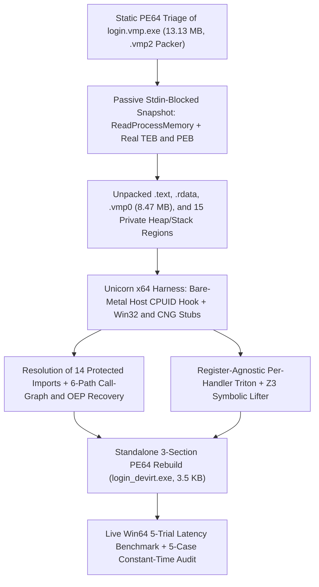
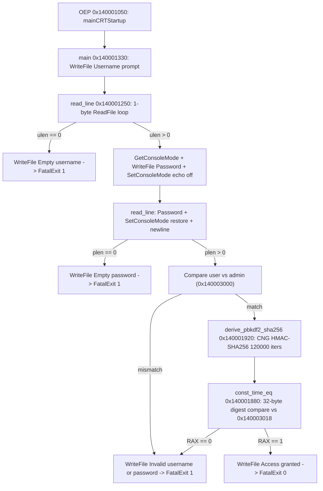

# Dissecting VMProtect x64 v3.10.4 Ultra: Passive Snapshot Unpacking, Host-CPUID Concolic Emulation, Register-Agnostic Triton Lifting, and `RDTSC`-Seeded Execution Variance in a Binary
 
**Specimen:** `login.vmp.exe` (`13,772,288 B`, PE32+ / AMD64, MSVC `14.44`, VMProtect x64 v3.x Ultra: Packing + Virtualization + Mutation + Import Protection)
**Reconstructed Output:** `login_devirt.exe` (`3,584 B`, standalone native Win64 PE64, `.vmp0`/`.vmp1`/`.vmp2` removed, `99.974%` size reduction)
**Before / After Binaries:** [https://github.com/est1mate/est1mate.github.io/tree/main/vmp](https://github.com/est1mate/est1mate.github.io/tree/main/vmp)
 
---
 
## Table of Contents
 
- [Abstract](#abstract)
- [1. Introduction](#1-introduction)
- [2. Background and Related Work](#2-background-and-related-work)
- [3. Ethical and Legal Framing](#3-ethical-and-legal-framing)
- [4. Methodology and Tooling Architecture](#4-methodology-and-tooling-architecture)
- [5. Specimen Triage, Unpacking, and Live Memory Anatomy](#5-specimen-triage-unpacking-and-live-memory-anatomy)
- [6. Deep White-Box VMProtect v3.x Dissection](#6-deep-white-box-vmprotect-v3x-dissection)
- [7. Recovered Semantics, Constant-Time & RDTSC Audit, and Benchmarks](#7-recovered-semantics-constant-time--rdtsc-audit-and-benchmarks)
- [8. Limitations and Threats to Validity](#8-limitations-and-threats-to-validity)
- [9. Conclusion](#9-conclusion)
- [References](#references)
---
 
## Abstract
 
Commercial virtualization protectors such as VMProtect v3.x compile native x64 functions into custom bytecode executed by per-build polymorphic virtual machines while layering packing, import obfuscation, runtime CRC-32 integrity checks, and anti-emulation traps on top. Existing academic literature focuses heavily on synthetic benchmarks or earlier single-instance VMProtect layouts (`RSI = VIP`, `RBP = VSP`).
 
We present a reproducible measurement and semantic-recovery study on a researcher-authored Windows x64 authentication executable (`login.vmp.exe`) implementing 120,000-iteration salted PBKDF2-HMAC-SHA256 via Windows CNG (`bcrypt.dll`) and constant-time 32-byte digest comparison, protected with a licensed installation of VMProtect x64 v3.x Ultra. Combining passive `ReadProcessMemory` acquisition with real `TEB`/`PEB` restoration, bare-metal host `CPUID` forwarding in Unicorn Engine, and register-agnostic per-handler symbolic lifting in Triton, we defeat VMProtect's implicit data-flow anti-emulation trap without patching the binary, resolve all 14 protected Win32 and CNG imports, recover the Original Entry Point (`0x140001050`) and call graph, and rebuild a standalone `3,584`-byte native PE64 executable (`login_devirt.exe`) verified byte-for-byte against `login.vmp.exe`.
 
Empirical measurements show four main results. First, VMProtect inflates on-disk size by `3,842.7×` (`3.5 KB` to `13.13 MB`) and executes `101,948` to `1,221,222` native x64 instructions per virtualized routine under pinned `RDTSC` (`4,625.8×` instruction blowup on a 32-byte comparison loop). Second, the specimen employs multiple coexisting register-rotating VM instances (`VIP=R9/VSP=R10`, `VIP=RBP/VSP=RDI`, and backward-stepping `VIP=RSI`) using tableless `adc r8, sext32(delta)` handler chaining, `vNOR64` bitwise synthesis, `call $+5` stack-depth poisoning (`40,734` executions, `3.24%`), and six layered encryption/masking primitives. Third, VMProtect folds `CPUID(1)` output, `PEB->OSBuildNumber` (`gs:[0x60]+0x120`), and `.vmp0` CRC-32 directly into pointer derivation rather than explicit `if`-branches, silently corrupting emulated pointers under stock Unicorn/QEMU. Fourth, controlled replication with pinned `CPUID` and `RDTSC` (`0x140261F9F`, `0x140288171`) shows that VMProtect **preserves** strict input-level constant-time invariance on the 32-byte comparison (`1,221,222` identical instructions across all five mismatch classes, `0` input delta), while injecting `~6%–16%` (`82k–195k` instructions) of `RDTSC`-seeded non-deterministic execution jitter that breaks naive single-trial trace diffing. Fixed protector startup and integrity overhead (`~793 ms`) exceeds `120,000` PBKDF2-HMAC-SHA256 iterations (`27.7 ms`) by `28.5×`, causing `26.97×–262.97×` wall-clock slowdowns on live Windows x64.
 
---
 
## 1. Introduction
 
Traditional binary packers encrypt or compress `.text` on disk and restore native x64 instructions in memory before jumping to an Original Entry Point (OEP). Virtualization obfuscators break that model completely [1]: even after the outer packing layer finishes unpacking into memory, the original instructions of protected functions no longer exist anywhere in the address space. They have been lowered into proprietary bytecode streams interpreted by a build-specific virtual machine.
 
When evaluating commercial protectors like VMProtect x64 v3.x, two engineering questions matter most in practice: how much real analytical friction and runtime cost does the virtualization stack impose, and what subtle side effects does it introduce when applied to security-critical code such as password hashing and constant-time comparison?
 
We investigate both questions empirically on `login.vmp.exe`, a researcher-authored Windows x64 console login binary backed by Windows CNG (`bcrypt.dll`) `BCryptDeriveKeyPBKDF2` (`120,000` iterations, HMAC-SHA256, 16-byte salt) and a constant-time 32-byte digest verifier. Specifically, we measure:
- **RQ1 (Space & Time Overhead):** Static PE64 expansion, entropy shifts, executed native x64 instruction inflation, and wall-clock latency relative to a clean native PE64 image.
- **RQ2 (Modern VMProtect v3.x Internals):** How `VM_ENTER`, register-rotating `VIP`/`VSP` assignment, `call $+5` stack poisoning, and rolling-key bytecode decryption operate in this build, and how effectively per-handler concolic Triton lifting collapses them.
- **RQ3 (Anti-Emulation Traps):** Why naive Unicorn emulation crashes inside virtualized import stubs and authentication handlers, and what exact host state restores faithful execution.
- **RQ4 (Constant-Time Preservation):** Whether wrapping a constant-time cryptographic comparison in VMProtect Ultra preserves instruction-count invariance across mismatch positions.
---
 
## 2. Background and Related Work
 
Everything in this section comes from published academic and reverse-engineering literature, kept strictly separate from the empirical measurements on `login.vmp.exe` in Sections 5–7.
 
Collberg, Thomborson, and Low [2] framed obfuscation evaluation along three axes: *potency* (human confusion), *resilience* (resistance to automated deobfuscation), and *cost* (size and execution overhead). Banescu, Ochoa, and Pretschner [3] formalized empirical resilience measurement against automated symbolic attacks, later using machine learning over symbolic path-constraint graph features to predict deobfuscation runtime [4].
 
Rolles [1] authored the foundational analysis of virtualization obfuscators, explaining why OEP dumpers cannot recover virtualized logic and outlining bytecode lifting into compiler-style IR. Yadegari et al. [5] showed that dynamic taint analysis and trace simplification can reconstruct semantics and control-flow graphs across diverse obfuscators without hardcoding the VM ISA. Salwan, Bardin, and Potet [6] pushed symbolic deobfuscation forward using the **Triton** dynamic binary analysis engine, lifting virtualized instruction traces into simplified SMT ASTs and re-emitting native code. Because deeply nested Mixed Boolean-Arithmetic (MBA) expressions can choke pure algebraic simplifiers, Blazytko et al. [7] introduced **Syntia**, using Monte Carlo Tree Search to synthesize concise handler semantics for VMProtect and Themida, while David, Coniglio, and Ceccato [8] paired Triton slicing with offline enumerative synthesis in **QSynth**.
 
In published RE documentation [1, 6, 7], VMProtect v3.x is characterized as a stack-machine RISC VM using `NOR`/`NAND`-complete bitwise primitives, rolling bytecode decryption, dead-store injection, and protected import stubs. Every register assignment, address, disassembly slice, anti-emulation fault, and timing figure from Section 5 onward is derived directly from `login.vmp.exe`.
 
---
 
## 3. Ethical and Legal Framing
 
This study is a standard defensive measurement exercise. Both the original source code and `login.vmp.exe` were built by the researcher using a legitimately licensed commercial protection tool. No third-party software, commercial DRM, external license server, or third-party intellectual property is touched. Nothing is redistributed or used to bypass commercial licensing; the sole objective is quantifying obfuscation cost, anti-emulation design, and constant-time side effects for academic documentation.
 
---
 
## 4. Methodology and Tooling Architecture
 
Rather than attaching a live debugger and fighting VMProtect's anti-debug and CRC-32 checks with patches, our pipeline separates unpacking, environment capture, emulation, symbolic lifting, and PE64 reconstruction into five deterministic stages:
 

 
### 4.1. Passive Process-State Acquisition (Zero Debugger, Zero Patches)
 
When invoked with piped stdin, `login.vmp.exe` finishes unpacking `.vmp0` and the original application sections in `~800 ms`, writes `"Username: "` to stdout, and blocks inside `ntdll!NtReadFile`. Because the process sits cleanly in kernel wait state with zero breakpoints, page-guard traps, or inline hooks, we capture a fully consistent process snapshot through read-only Win32 APIs:
 
1. Spawn `login.vmp.exe` unmodified with an open stdin pipe and wait `1.0 s` until the `.vmp2` loader finishes unpacking and parks the main thread in `NtReadFile`.
2. Open the process with `PROCESS_VM_READ | PROCESS_QUERY_INFORMATION` and query `NtQueryInformationProcess(ProcessBasicInformation)` to obtain `PebBaseAddress` (`0x3FF000`), alongside `NtQueryInformationThread(ThreadBasicInformation)` on the suspended main thread to obtain `TebBaseAddress` (`0x200000`) and full `CONTEXT64` registers (`RIP = 0x7FFF656AD674`, `RSP = 0x14FC98`, `RBP = 0x14FE20`).
3. Dump the `TEB` (`8 KB`), `PEB` (`4 KB`), the full `22.6 MB` mapped image (`0x140000000..0x1415A2000`, `5,538` pages) using `64 KB` chunked `ReadProcessMemory` transfers (falling back to `4 KB` granularity at region edges), and walk `VirtualQueryEx` across user space to capture all `15` committed `MEM_PRIVATE` regions (`<= 4 MB`, skipping `PAGE_NOACCESS` / `PAGE_GUARD`) containing the live stack, process heap, and VMProtect's private syscall stubs.
4. Resume the thread and feed dummy input so the process exits cleanly (`rc = 1`).
### 4.2. Bare-Metal Host `CPUID` Forwarding and CNG Emulation in Unicorn
 
As detailed in Section 6.1, Unicorn's built-in QEMU `CPUID` emulation poisons VMProtect's runtime pointer arithmetic. We resolve this by loading the consistent `22.6 MB` image, all `15` private regions, real `TEB`/`PEB` (`GS_BASE = 0x200000`, `OSBuildNumber = 19045`), and the four mapped Windows system DLLs (`ntdll.dll`, `kernel32.dll`, `kernelbase.dll`, `bcrypt.dll`) into Unicorn `2.1.4`, then registering a `UC_HOOK_INSN` callback on `UC_X86_INS_CPUID`. On every virtualized `cpuid`, the callback executes a 24-byte native x64 `cpuid` sequence on the bare-metal host CPU (`push rbx; mov eax, ecx; mov ecx, edx; cpuid; mov [r8+0..12], eax/ebx/ecx/edx; pop rbx; ret`) and writes the genuine host `EAX/EBX/ECX/EDX` values directly back into Unicorn.
 
To keep emulation fast across millions of VMProtect instructions, we scope `UC_HOOK_CODE` strictly to the four DLL address ranges so `.vmp0` executes at native Unicorn JIT speed. At exact export entry points, our harness emulates Win32 console I/O (`GetStdHandle`, `ReadFile`, `WriteFile`, `GetConsoleMode`, `SetConsoleMode`, `FatalExit`) and Windows CNG (`BCryptOpenAlgorithmProvider`, `BCryptDeriveKeyPBKDF2` backed by real `120,000`-iteration HMAC-SHA256 key derivation, and `BCryptCloseAlgorithmProvider`), popping the return address from `[RSP]` and placing the return status in `RAX`.
 
### 4.3. Register-Agnostic Per-Handler Triton + Z3 Lifting
 
Because VMProtect v3.x rotates `VIP` and `VSP` across VM instances (e.g., `R9/R10` vs `RBP/RDI` vs `RSI/RBP`), hardcoding `RBP` as `VSP` produces invalid ASTs. We slice instruction traces at indirect handler dispatch boundaries (`jmp reg` and `ret` inside `.vmp0`) and infer `VSP` and `VIP` per handler directly from pre/post register deltas: `VSP` is selected as the non-`RSP` register pointing into the stack arena whose delta lies in `{±2, ±4, ±8, ±16}`, while `VIP` is the `.vmp0`-pointing register advancing by small bytecode deltas (`-64..+64`). For each unique handler slice, we instantiate a clean `TritonContext(ARCH.X86_64)` with `ALIGNED_MEMORY`, `CONSTANT_FOLDING`, and `AST_OPTIMIZATIONS`, seed bytecode and code reads concretely from Unicorn, symbolize the top six virtual stack qwords (`vSTK_00..vSTK_28`), VM context scratch slots (`vCTX_00..vCTX_D8`), and input buffer bytes (`bufA_*`, `bufB_*`), step the native x64 slice, and simplify all modified stack and context slots via `simplify(ast, solver=True)`.
 
---
 
## 5. Specimen Triage, Unpacking, and Live Memory Anatomy
 
### 5.1. On-Disk PE64 Container (`login.vmp.exe`)
 
`login.vmp.exe` (`MD5: efccbbac47b466f897b9424ae900ddde`, `SHA256: 619f45b4a984cc430477b453d3aec7101dddbec094db5db0f40c46a76dd518b7`) is `13,772,288` bytes (`13.13 MB`) with whole-file entropy `7.6930`. Headers show `Machine = 0x8664`, `Magic = 0x20B`, `Linker = 14.44` (VS 2022), `Subsystem = 3` (CUI), `ImageBase = 0x140000000`, `SizeOfImage = 0x15A2000` (`21.6 MB`), `DllCharacteristics = 0x8120` (`NX_COMPAT = True`, `DYNAMIC_BASE = False`), and `EntryPoint = 0x1414DAE11` inside `.vmp2`. Detect It Easy (`0.5.0`, deep scan) returns `PE64 / Unknown: Unknown`.
 
The static IAT at `0x14087F000` (`.vmp1`) lists only two exports: `KERNEL32.dll!ReadFile` (`0x14087F000`) and `bcrypt.dll!BCryptOpenAlgorithmProvider` (`0x14087F010`). Every original application section—plus the `8.47 MB` `.vmp0` VM section—has `RawSize = 0` on disk, packed inside `.vmp2`:
 
| Section | RVA | VirtualSize | RawOffset | RawSize | Perms | Disk Ent | Live Ent | Contents |
| :--- | :--- | ---: | ---: | ---: | :-: | :-: | :-: | :--- |
| `.text` | `0x1000` | `7,223 B` | `0x0` | `0 B` | `R-X` | `0.0000` | `3.3663` | Active stubs `0x1000..0x1BF0`; `0x1C30..0x2C37` zero/CC |
| `.rdata` | `0x3000` | `1,758 B` | `0x0` | `0 B` | `R--` | `0.0000` | `2.7761` | `"admin"`, 16 B salt, 32 B digest, prompts, `L"SHA256"` |
| `.pdata` | `0x4000` | `504 B` | `0x0` | `0 B` | `R--` | `0.0000` | `3.5341` | Scrambled original `.pdata` (real dir moved to `.vmp2`) |
| `.idata` | `0x5000` | `1,255 B` | `0x0` | `0 B` | `R--` | `0.0000` | `4.3632` | Scrambled original `.idata` |
| `.vmp0` | `0x6000` | `8,881,623 B` | `0x0` | `0 B` | `R-X` | `0.0000` | `7.3379` | Unpacked `8.47 MB` VMProtect v3.x VM + bytecode |
| `.vmp1` | `0x87F000` | `88 B` | `0x400` | `512 B` | `RW-` | `0.2351` | `3.4110` | Minimal loader IAT (8 runtime pointers) |
| `.vmp2` | `0x880000` | `13,770,300 B` | `0x600` | `13,770,752 B` | `RWX` | `7.6934` | `7.6935` | Entry `0x1414DAE11`, VM unpacker, compressed payload |
 
Disassembling `.vmp2` Entry Point `0x1414DAE11` immediately shows VMProtect's trademark mutated VM-entry sequence (`push rdx; movabs rdx, junk; pushfq; shr/shl; call 0x140EDCF72` followed by unreachable junk bytes):
 
```nasm
0x1414DAE11: 52                       push    rdx
0x1414DAE12: 48 ba 07 75 8e 75 12 86 19 af  movabs rdx, 0xaf198612758e7507
0x1414DAE1C: 9c                       pushfq
0x1414DAE1D: c1 ea c6                 shr     edx, 0xc6
0x1414DAE20: c0 e2 2f                 shl     dl, 0x2f
0x1414DAE23: e8 4a 21 a0 ff           call    0x140EDCF72  ; VM_ENTER for .vmp2 unpacker
```
 
### 5.2. Live Snapshot Anatomy and Runtime Syscall Trampolines
 
Our passive capture dumped `5,538 / 5,538` pages of `login.vmp.exe` (`0` errors) plus `15` `MEM_PRIVATE` regions, real `TEB = 0x200000`, and real `PEB = 0x3FF000` (`OS = 10.0.19045`). Only four system DLLs were mapped (`ntdll.dll@0x7fff65610000`, `kernel32.dll@0x7fff648f0000`, `kernelbase.dll@0x7fff62ef0000`, `bcrypt.dll@0x7fff631f0000`)—confirming the binary was linked without standard MSVC CRT bloat.
 
Two runtime artifacts surfaced immediately in the private regions:
1. **Six loader APIs dynamically resolved into `.vmp1` (`0x14087F028..0x14087F050`):** `GetModuleHandleA`, `LoadLibraryA`, `GetProcAddress`, `ntdll!RtlAllocateHeap`, `HeapFree`, and `FatalExit`.
2. **Runtime `RX`/`RWX` Syscall Trampoline Pages (`0x7FFF65810000` and `0x7FFF65820000`, allocated directly above `ntdll.dll`):** VMProtect copies clean syscall prologues (e.g., syscall `0x50` = `NtProtectVirtualMemory`) into private `RX` pages so it can invoke `ntdll` syscalls without being tripped by inline user-mode hooks on `ntdll.dll`:
```nasm
0x7FFF65810000: 4c 8b d1              mov  r10, rcx
0x7FFF65810003: b8 50 00 00 00        mov  eax, 0x50          ; NtProtectVirtualMemory SSN
0x7FFF65810008: e9 9b df e9 ff        jmp  0x7FFF656ADFA8     ; jump past ntdll prologue straight to syscall
```
 
Walking the suspended main thread's stack at `RIP = 0x7FFF656AD674` (`ntdll!NtReadFile`, `RSP = 0x14FC98`) pinpointed the exact active call frame:
 
```text
0x14FC98 (+0x00): 0x00007FFF62F1DC43  [kernelbase.dll!ReadFile + 0x73]
0x14FCC0 (+0x28): 0x000000000014FCF0  [IO_STATUS_BLOCK]
0x14FCC8 (+0x30): 0x000000000014FF00  [lpBuffer: 1-byte char read target]
0x14FCD0 (+0x38): 0x0000000000000001  [nNumberOfBytesToRead = 1]
0x14FD18 (+0x80): 0x000000014052D3E0  [.vmp0 return address right after `call 0x1407D161C` -> ReadFile!]
0x14FD38 (+0xA0): 0x000000000014FF08  [lpNumberOfBytesRead]
0x14FEF8 (+0x260): 0x0000000140520924 [.vmp0 outer OEP frame -> FatalExit]
```
 
Meanwhile, `.pdata` at `0x140004000` contained scrambled garbage (`0x18D7C9212..0x19149CE55`), because VMProtect relocated the real `IMAGE_DIRECTORY_ENTRY_EXCEPTION` to `.vmp2` (`0x14159F160`, `957` `RUNTIME_FUNCTION` entries). Filtering that relocated table for `0x1000 <= BeginAddress < 0x3000` recovered all `16` original `.text` functions (`0x140001050..0x140001B5E`), fronted by an MSVC Incremental Linking Table (`0x140001005..0x14000101E`) and followed by `14` 6-byte protected import thunks (`0x140001B95..0x140001BE3`). Every `.text` function had its original body overwritten with random junk bytes after a `call .vmp0` or mutated Ultra prologue:
 
| # | `.text` Range | Size | ILT Thunk | VMP Entry Target | Observed Role |
| :-: | :--- | ---: | :--- | :--- | :--- |
| 00 | `0x140001050..0x140001062` | `18 B` | — | `jmp 0x140857DA7` | **OEP (`mainCRTStartup`)** -> calls `main` + `FatalExit` |
| 01 | `0x140001070..0x1400010E3` | `115 B` | — | Mutated -> `call 0x1407CE806` | Console output helper (`write_str`) |
| 02 | `0x140001100..0x140001202` | `258 B` | — | `call 0x14079E190 -> 0x1400601FC` | Echo-masked password reader (`GetConsoleMode`/`SetConsoleMode`) |
| 03 | `0x140001250..0x14000127C` | `44 B` | — | `call 0x14078E3A8` | 1-byte `ReadFile` line reader |
| 04–05 | `0x14000127C..0x1400012FA` | `126 B` | — | Inlined / junk tail | Fragmented tail of `read_line` / helper chunks |
| 06 | `0x140001330..0x140001415` | `229 B` | — | Mutated -> `call 0x1407591FD` | **`main()`** — prompts, validation, auth dispatch |
| 07–09 | `0x140001415..0x1400016C2` | `685 B` | — | Inlined into `0x1407591FD` | Virtualized body blocks of `main()` overwritten with junk |
| 10 | `0x140001810..0x14000185F` | `79 B` | — | Mutated -> `call 0x14074CEEB` | Internal string/buffer helper |
| — | `0x140001880..0x1400018B9` | `57 B` | `0x140001019` | Mutated -> `jns 0x14083B02F` | **`const_time_eq(a, b, len)`** (32-byte digest verifier) |
| 11 | `0x1400018D0..0x140001904` | `52 B` | `0x140001005` | `call 0x1400163CF` | CNG HMAC-SHA256 helper (`BCryptOpenAlgorithmProvider`, `0x8`) |
| 12 | `0x140001920..0x1400019DB` | `187 B` | `0x14000101E` | `call 0x14001D210` | **`derive_pbkdf2_sha256`** (`120,000` iters, salt `0x140003008`) |
| 13 | `0x140001A10..0x140001A31` | `33 B` | `0x14000100F` | `call 0x14071DF27` | Auxiliary crypto/zeroing helper (unreached on login path) |
| 14 | `0x140001A40..0x140001A6C` | `44 B` | `0x140001014` | `call 0x14077BE50` | Auxiliary SHA-256 helper (`BCryptOpenAlgorithmProvider`, `0x0`) |
| 15 | `0x140001A80..0x140001B5E` | `222 B` | — | `call 0x140761FC4` | Auxiliary CNG hash helper (unreached on login path) |
 
Unpacked `.rdata` (`0x140003000..0x1400030E6`) survived in plaintext:
 
```text
0x140003000 ( 6 B): "admin\0"
0x140003008 (16 B): e4 ea cc b0 19 8d 5f f0 f1 58 3d 9c 5b d5 82 b6   ; PBKDF2 Salt
0x140003018 (32 B): e4 2d 8f d7 1a 2b 34 28 46 81 97 b1 e8 4d 25 e3
                    39 7e 70 4f ba ef ac 6d cc fc e6 69 f1 36 9d d7   ; Expected 32-byte DK
0x140003048 (11 B): "Username: \0"
0x140003058 (17 B): "Empty username.\n\0"
0x140003070 (11 B): "Password: \0"
0x140003080 (17 B): "Empty password.\n\0"
0x140003098 (31 B): "Invalid username or password.\n\0"
0x1400030C0 (17 B): "Access granted.\n\0"
0x1400030D8 (14 B): L"SHA256\0" (UTF-16LE)
```
 
### 5.3. `.vmp2` Outer Unpacker Layer: Entropy Segmentation, LZMA Payload, and Unpacking Flow
 
Comparing on-disk `.vmp2` (`13,770,752 B`) byte-for-byte against the live post-unpack memory snapshot shows **`0` self-modified bytes** inside `.vmp2` at runtime—it acts as a read-only virtualized unpacker engine paired with a compressed payload blob. Profiling `.vmp2` in `1 MB` windows cleanly separates its two internal regions:
 
| `.vmp2` VA Window | Size | Shannon Entropy | Structural Role |
| :--- | ---: | :-: | :--- |
| `0x140880000 .. 0x140D80000` | `5.0 MB` | `7.0560 – 7.1203` | Virtualized `.vmp2` unpacker VM handlers and mutated loader code |
| `0x140D80000 .. 0x140E80000` | `1.0 MB` | `5.6345` | Sparse `.vmp2` metadata, string/import tables, and lookup tables |
| `0x140E80000 .. 0x140F80000` | `1.0 MB` | `7.4933` | Transition boundary (`VM_ENTER @ 0x140EDCF72` + stream header) |
| `0x140F80000 .. 0x141580000` | `6.0 MB` | `7.9964 – 7.9998` | **Compressed payload** (`.vmp0` `8.47 MB` + `.text`/`.rdata`/`.pdata`/`.idata` packed at `~70%` ratio) |
| `0x141580000 .. 0x1415A2000` | `135.6 KB` | `7.8388` | Relocated `IMAGE_DIRECTORY_ENTRY_EXCEPTION` (`0x14159F160`, `957` entries) |
 
Static signature scanning of `.vmp2` matches classic LZMA range-decoder constants (`kTopValue = 0x01000000`: `40` occurrences; `kBitModelTotal = 0x00000800`: `431` occurrences; `0x0400` initial probability table values: `1,363` occurrences). Emulating the disk-packed image directly from Entry Point `0x1414DAE11 -> 0x140EDCF72` for `120,000` instructions in Unicorn (`err = None`) confirms that the outer unpacker itself runs inside its own dedicated VMProtect v3.x VM instance (`0x14088659C / 0x140886658`) sharing the identical `0x2D0`-byte stack geometry (`RSP = 0x20FFD30`) with forward-stepping `VIP = R9` (`0x14154EC94 -> 0x14154ECD8 -> 0x14154ED01 -> 0x14154ED15 -> 0x14154ED32`).
 
Combining the `.vmp2` emulator trace with the live stack and private-page artifacts recovered in Section 5.2 reconstructs the exact six-stage `.vmp2` startup sequence before control reaches OEP `0x140001050`:
1. **Dynamic Loader Resolution:** Uses the two static `.vmp1` imports (`ReadFile`, `BCryptOpenAlgorithmProvider`) and PEB/export walking to resolve `GetModuleHandleA`, `LoadLibraryA`, `GetProcAddress`, `RtlAllocateHeap`, `HeapFree`, and `FatalExit` into `.vmp1` (`0x14087F028..0x14087F050`).
2. **Clean `ntdll.dll` Remapping:** Invokes `ZwOpenSection` / `ZwMapViewOfSection` / `ZwUnmapViewOfSection` on `\KnownDlls\ntdll.dll` and emits unhooked direct-syscall trampolines (`SSN 0x50 = NtProtectVirtualMemory`) into private `RX` pages (`0x7FFF65810000`, `0x7FFF65820000`).
3. **Anti-Debug & Anti-Attach Hardening:** Executes `ZwSetInformationThread` (`ThreadHideFromDebugger`), `ZwQueryInformationProcess`, `ZwQuerySystemInformation`, and targets `ntdll!DbgUiRemoteBreakin`.
4. **Section Unpacking:** Calls `ZwProtectVirtualMemory` to make the zero-initialized `RawSize = 0` sections writable, then decompresses the `6.0 MB` LZMA stream (`0x140F80000..0x141580000`) into `.text` (`0x140001000`), `.rdata` (`0x140003000`), `.pdata` (`0x140004000`), `.idata` (`0x140005000`), and `.vmp0` (`0x140006000`, `8.47 MB`).
5. **Runtime Heap & CRC Setup:** Allocates private heap state (`0x490000` / `0x4A7590`), initializes CRC-32 tables, and restores final section protections (`R-X` on `.text`/`.vmp0`, `R--` on `.rdata`).
6. **OEP Handoff:** Transfers execution to OEP `0x140001050` (`jmp 0x140857DA7` into `.vmp0`).
---
 
## 6. Deep White-Box VMProtect v3.x Dissection
 
### 6.1. Debugging Chronicle: Defeating the Implicit `CPUID` + `PEB` + CRC-32 Anti-Emulation Trap
 
Getting Unicorn to execute `login.vmp.exe` cleanly from start to finish exposed three layered runtime traps—each failing silently through corrupted memory pointers rather than explicit anti-debug exit calls:
 
1. **Trap 1 — Missing Private Heap (`0x4A7590`):** Emulating import thunk #0 (`0x140001B95 -> 0x14085366D`) with only the `22.6 MB` PE image mapped ran `97,078` instructions—including a `745`-iteration table-driven CRC-32 loop at `0x14020FB2E` hashing `.vmp0` bytes (`0x140238D33..`):
```nasm
0x14020FB36: movzx r8d, byte ptr [r10]         ; read .vmp0 byte
0x14020FB40: xor   r8d, eax                    ; crc ^ byte
0x14020FB43: and   r8d, 0xff
0x14020FB4A: mov   r8d, dword ptr [rdi + r8*4] ; CRC-32 lookup table
```
   and then faulted at `0x1402E2960` reading `0x4A7590` (VMProtect's runtime heap state). Capturing all `15` `MEM_PRIVATE` regions from the same live process resolved Trap 1.
 
2. **Trap 2 — `PEB->OSBuildNumber` Folded Into Pointer Math (`0x769462D04CC9` -> `0x769462FE0369`):** With the heap mapped, all `14` thunks ran `105k–246k` instructions before faulting on a 2-byte read (`mov dx, word ptr [r8 + rbx*2 - 0xf4]` at `0x1402E9D4E`) at unmapped 48-bit addresses (`0x769462D04CC9`). Swapping in the genuine `TEB` (`0x200000`) and `PEB` (`0x3FF000`, where `PEB+0x120 = 0x4A65 = 19045`) shifted the exact fault address of `0x140001B95` by `+0x2DB6A0` (`0x769462D04CC9 -> 0x769462FE0369`). Tracing external reads after `WriteFile("\n")` caught the exact instructions folding `PEB` directly into virtual stack arithmetic:
```nasm
0x140250F4B: add  rax, qword ptr gs:[rdx + r9*4]    ; reads TEB+0x60 -> PEB (0x3FF000) into ADD
0x1402515A5: mov  r11w, word ptr [r9 + rdx*4]       ; reads PEB+0x120 -> OSBuildNumber (0x4A65)
0x1402515AE: mov  word ptr [rdx + rdi + 0x16], r11w ; pushes OSBuildNumber onto virtual stack
```
 
3. **Trap 3 — `vCPUID` Spilling `CPUID(1)` Directly Onto the Virtual Stack (`0x1402445F9`):** Tracing special opcodes between `WriteFile("\n")` and the fault at `0x1402611A0` (`0xE2922774632C1`) revealed `cpuid` at `0x1402445F9` (and `0x14033DC90`), immediately writing all four `CPUID(1)` output registers onto VMProtect's virtual stack:
```nasm
0x1402445F9: cpuid
0x140244607: mov  dword ptr [r11 + r8 - 0x23], eax       ; push CPUID(1).EAX
0x140244613: mov  dword ptr [r11 + r8*8 - 0x11c], ebx    ; push CPUID(1).EBX
0x140244620: mov  dword ptr [r11 + r8*2 - 0x4e], ecx     ; push CPUID(1).ECX (bit 31 = hypervisor!)
0x140244625: mov  eax, edx                               ; push CPUID(1).EDX
```
   Under stock Unicorn/QEMU, `CPUID(1)` sets `ECX` bit 31 (`0x80000000`, hypervisor present) and returns QEMU CPU identifiers, whereas the bare-metal host returns `[EAX=0x00A20F12, EBX=0x060C0800, ECX=0x7EF8320B, EDX=0x178BFBFF]`. Because VMProtect feeds `CPUID(1)` straight into its pointer-decryption key chain, there is no `jz/jnz` anti-VM branch to patch—wrong CPUID bits silently corrupt every decrypted API address into an unmapped 48-bit garbage pointer.
 
Hooking `UC_X86_INS_CPUID` with the 24-byte host `cpuid` trampoline instantly fixed everything: all `14/14` protected import thunks at `0x140001B95..0x140001BE3` resolved cleanly to their exact Win32 and `bcrypt.dll` exports, and the full authentication run completed with `err = None`:
 
| Thunk VA | Resolved Export | Thunk VA | Resolved Export |
| :--- | :--- | :--- | :--- |
| `0x140001B95` | `kernel32.dll!GetStdHandle` | `0x140001BBF` | `bcrypt.dll!BCryptCloseAlgorithmProvider` |
| `0x140001B9B` | `kernel32.dll!ReadFile` | `0x140001BC5` | `bcrypt.dll!BCryptCreateHash` |
| `0x140001BA1` | `kernel32.dll!WriteFile` | `0x140001BCB` | `bcrypt.dll!BCryptHashData` |
| `0x140001BA7` | `kernel32.dll!FatalExit` | `0x140001BD1` | `bcrypt.dll!BCryptFinishHash` |
| `0x140001BAD` | `kernel32.dll!GetConsoleMode` | `0x140001BD7` | `bcrypt.dll!BCryptDestroyHash` |
| `0x140001BB3` | `kernel32.dll!SetConsoleMode` | `0x140001BDD` | `bcrypt.dll!BCryptGenRandom` |
| `0x140001BB9` | `bcrypt.dll!BCryptOpenAlgorithmProvider` | `0x140001BE3` | `bcrypt.dll!BCryptDeriveKeyPBKDF2` |
 
### 6.2. `VM_ENTER`, Per-VM Spill Randomization, and Virtual Stack Frame Layout
 
Every virtualized `.text` stub cancels its return address, pushes a 32-bit encrypted bytecode key, and calls `VM_ENTER` (e.g., `0x140001100 -> 0x14079E190 -> 0x1400601FC`). Inspecting `0x1400601FC` shows how VMProtect v3.x replaces ordinary `push reg` context spills with `call $+5` slot allocation plus opaque base-offset cancellation (`EAX = 0x69BCEAA`):
 
```nasm
0x1400601FC: push 0x4f1b9a12                              ; allocate slot
0x140060201: mov  qword ptr [rsp], rax                    ; [rsp] = rax (push rax)
0x140060206: mov  eax, 0x69bceaa                          ; opaque constant C = 0x69BCEAA
0x14006020B: push rbx
0x14006020F: call 0x140060214                             ; call $+5 allocates 8-byte stack slot
0x140060214: mov  qword ptr [rsp + rax - 0x69bceaa], r8   ; C - C == 0 -> [rsp] = r8 (push r8)
...
0x14006022C: call 0x140060231                             ; call $+5 allocates 8-byte stack slot
0x140060231: mov  qword ptr [rsp + rax - 0x69bceaa], r14  ; C - C == 0 -> [rsp] = r14 (push r14)
0x14006023C: push r10
0x14006023E: call 0x140060243                             ; call $+5 slot 1
0x140060243: call 0x140060248                             ; call $+5 slot 2
0x140060248: mov  qword ptr [rsp + rax*4 - 0x1a6f3aa0], r9; 4*0x69BCEAA = 0x1A6F3AA8 -> [rsp+8] = r9!
0x140060250: cbw
0x140060252: mov  qword ptr [rsp + rax - 0x69bffaa], rsi  ; sign-ext al(0xAA)->0xFFAA -> [rsp] = rsi!
```
 
That `4 * 0x69BCEAA - 0x1A6F3AA0 == +8` and `cbw` (`0x69BCEAA -> 0x69BFFAA`, canceling `-0x69BFFAA == 0`) trick breaks naive pattern matchers looking for consecutive `push` instructions at `VM_ENTER`, yet collapses to zero under Triton constant folding.
 
Injecting 15 unique 64-bit magic sentinels (`RAX = 0x1111111111110001` .. `R15 = 0xFFFFFFFFFFFF000F`) prior to `VM_ENTER` across two different virtualized functions (`0x140001880` and `0x140001920`) proves that VMProtect independently permutes the native register save order per VM instance while allocating a fixed `0x2D0`-byte (`720`-byte) VM workspace below `entry_RSP`:
 
| Saved Native GPR | `0x140001880` (`const_time_eq`) Stack Offset | `0x140001920` (`derive_pbkdf2_sha256`) Stack Offset |
| :--- | :--- | :--- |
| `RDI` | `[entry_RSP - 0x08]` (`0x140001880`) | `[entry_RSP - 0x08]` (`0x140059D69`) |
| `RBP` | `[entry_RSP - 0x38]` (`0x140047034`) | `[entry_RSP - 0x10]` (`0x140059CA7`) |
| `RCX` | `[entry_RSP - 0x28]` (`0x14004701D`) | `[entry_RSP - 0x18]` (`0x140059C8C`) |
| `RAX` | `[entry_RSP - 0x18]` (`0x14004700A`) | `[entry_RSP - 0x30]` (`0x140059CAF`) |
| `RBX` | `[entry_RSP - 0x70]` (`0x140047054`) | `[entry_RSP - 0x68]` (`0x140059CF4`) |
| `RDX` | `[entry_RSP - 0x68]` (`0x140047053`) | `[entry_RSP - 0x78]` (`0x140059D0B`) |
| `RSI` | `[entry_RSP - 0x18]` (`0x140001890`) | `[entry_RSP - 0x88]` (`0x140059D20`) |
| **First Dispatch** | `0x1400471B6` (`step 117`, `RSP = entry_RSP - 0x2D0`, `VSP = entry_RSP - 0x88`) | `0x1401B4948` (`step 212`, `RSP = entry_RSP - 0x2D0`, `VSP = entry_RSP - 0x78`) |
 
Resulting live runtime stack geometry inside VMProtect v3.x (`entry_RSP = 0x2100000`):
 
```text
High Addresses
+-------------------------------------------------------------------+ 0x2100000 (entry_RSP)
| Return Address to Caller (0xDEAD0000 / .vmp0 caller frame)        | [entry_RSP + 0x00]
+-------------------------------------------------------------------+ 0x20FFFF8
| Spilled Native GPRs & RFLAGS (randomized order per VM instance)   | [entry_RSP - 0x08 .. -0x88]
+===================================================================+ 0x20FFF78 (Initial VSP)
| Virtual Stack Growth Zone (grows downward toward vCTX)            |
|   * Instance A: R10 = VSP (steps by +-2 / +-4 / +-8 / +-16)       |
|   * Instance B: RDI = VSP (steps by +-2 / +-10 / +-16)            |
|   * Guard threshold checked at VM_EXIT: cmp VSP, [RSP + 0x1C8]    |
+-------------------------------------------------------------------+ 0x20FFEF8 (RSP + 0x1C8)
| Virtual Register File (vCTX: 24-32 64-bit virtual scratch slots)  | [RSP + 0x00 .. +0x1C0]
|   * Accessed via [RSP + decoded_r11b + 0x30] + opaque RBX base    |
+-------------------------------------------------------------------+ 0x20FFD30 (Active RSP)
| Transient Native Stack (ephemeral `call $+5` junk slots flushed   |
|   before every handler exit via `pop rcx; ...` / `lea rsp`)       |
+-------------------------------------------------------------------+
Low Addresses
```
 
### 6.3. Multi-Instance Register-Rotating Architecture, Relative-Delta Dispatch, and Handler Statistics
 
Empirical register-invariant profiling across all `10,607` indirect handler dispatches (`9,737` `JMP_REG`, `870` `RET`) in `0x140001880` (`const_time_eq`) and `225` dispatches in `0x140001920` (`derive_pbkdf2_sha256`) disproves the textbook single-`(RSI, RBP)` stereotype for modern VMProtect v3.x:
 
| Register | `%` in `.vmp0` | `%` in Stack | `%` Const | Small Deltas | Neg | Pos | Unique Vals | Inferred Role in `0x140001880` |
| :--- | ---: | ---: | ---: | ---: | ---: | ---: | ---: | :--- |
| `RSP` | `0.0%` | `100.0%` | `54.9%` | `4,782` | `2,495` | `2,287` | `20` | Native stack / `vCTX` anchor (`0x20FFD30`) |
| `R8` | `85.3%` | `4.8%` | `24.8%` | `207` | `134` | `73` | `740` | **`VBASE` handler cursor** (`adc r8, sext32(delta)`) |
| `R9` | `60.8%` | `0.6%` | `20.0%` | `4,849` | `148` | `4,701` | `1,170` | **VM Instance A `VIP`** (forward `+4..+28 B`) |
| `R10` | `1.0%` | `59.2%` | `24.9%` | `4,469` | `2,380` | `2,089` | `864` | **VM Instance A `VSP`** (`±2/±4/±8/±16 B`) |
| `RBP` | `37.5%` | `8.3%` | `13.8%` | `2,370` | `34` | `2,336` | `1,028` | **VM Instance B `VIP`** (forward `+6..+30 B`) |
| `RDI` | `12.2%` | `29.1%` | `18.6%` | `3,333` | `1,529` | `1,804` | `835` | **VM Instance B `VSP`** (`±2/±10/±16 B`) / rolling key |
| `R12–R15` | `0.0%` | `0.0%` | `100.0%` | `0` | `0` | `0` | `1–2` | Unused callee-saved registers |
 
Meanwhile, `0x140001920` (`derive_pbkdf2_sha256`, `101,948` native instructions under pinned `RDTSC` [`173,540` unpinned], `454` `JMP_REG`/`RET` dispatches, `409` unique handler VAs, `224.56` insns/handler) and the import thunks (`0x140001B95`) use a third **backward-stepping VM instance** (`VIP = RSI`, negative deltas `-6, -7, -14, -30, -60 B`).
 
Aggregate structural metrics across one complete `EQUAL` run of `0x140001880` (`len = 32`, unpinned `RDTSC` trace):
- **Executed native instructions:** `1,221,222` (pinned `RDTSC`) / `1,135,478–1,331,028` (live `RDTSC`) across `~10,607` handler dispatches (`829` unique handler addresses).
- **Handler size distribution:** `min = 1`, `median = 83.0`, `mean = 117.65`, `p90 = 180`, `max = 100,815` (the outlier corresponds to the inline `.vmp0` CRC-32 integrity block).
- **Stack-poisoning `call $+5` (`E8 00 00 00 00`) density:** **`40,734`** executions in a single 32-byte compare—**`3.24%` of all executed native instructions** are zero-displacement dummy calls used solely to break static stack-depth tracking.
- **Bytecode scattering span:** `VIP (R9)` ranges over `0x14000E48F..0x140870C4F` (`8,792,000 B`, `6,449` dispatches) and `VIP (RBP)` ranges over `0x14000E493..0x140870CCA` (`8,792,119 B`, `3,981` dispatches)—bytecode fragments are scattered across virtually the entire `8.47 MB` `.vmp0` section rather than packed into a contiguous array.
#### Annotated Top-15 Triton-Lifted VMProtect v3.x Handler Catalog (`0x140001880`)
 
Running our register-agnostic Triton + Z3 lifter over the top `50` hottest unique handlers (`5,980` total executions out of `829` unique targets in `0x140001880`) directly recovered stack pushes, shifts, `vNOR64`, and virtual-context transfers across both VM Instance A (`R9/R10`) and VM Instance B (`RBP/RDI`):
 
| Handler VA | Execs | Insns | `VIP` (`Δ`) | `VSP` (`Δ`) | Canonical Role | Triton + Z3 Simplified Effect |
| :--- | :-: | :-: | :--- | :--- | :--- | :--- |
| `0x140337FA9` | `631` | `51` | pipelined | `R10 (-16)` | `vPUSH_VREG64` | `vSTK_post[+0] = vCTX[dec(r11b)]` (`(_ bv0 64)`) |
| `0x140337E83` | `469` | `71` | `R9 (+6)` | `R10 (+0)` | `vDISPATCH_A` | Decrypts delta `-> adc r8`, pre-fetches `r11b` |
| `0x1402E54A5` | `360` | `93` | `RDI (+6)` | `RBP (+0)` | `vDISPATCH_B` | Secondary VM instance dispatch / flag update |
| `0x14019E7D2` | `277` | `110` | `RBP (+6)` | `RDI (-16)` | `vPUSH_VREG64` | `vSTK_post[+0..+8] = vCTX[...]` + inline VSP guard |
| `0x1401D293F` | `274` | `156` | `R9 (+20)` | `R10 (+0)` | `vSTACK_OP` | `vSTK_post[+0] = vSTK_00 ; vSTK_post[+8] = vSTK_08` |
| `0x140197C02` | `168` | `97` | `R9 (+20)` | `R10 (-8)` | `vPUSH_IMM64` | `vSTK_post[+0] = 0x9849b21899a26d73` (64-bit imm) |
| `0x140208D29` | `162` | `191` | `R9 (+13)` | `R10 (+8)` | `vPOP_VREG` | `vSTK_post[-8] = vSTK_00 ; vSTK_post[+0] = vSTK_08` |
| `0x1401C0E0D` | `133` | `277` | `RBP (+30)` | `RDI (+16)` | `vPOP_DUAL` | `vSTK_post[-8] = vSTK_08 ; vSTK_post[+0] = vSTK_10` |
| `0x14029DD91` | `131` | `128` | `R9 (+20)` | `R10 (-8)` | `vPUSH_IMM64` | `vSTK_post[+0] = 0x6799680b6a64c26b` (64-bit imm) |
| `0x1401D303D` | `130` | `180` | `R9 (+11)` | `R10 (-4)` | `vPUSH_IMM32` | `vSTK_post[+0] = concat(vSTK_00[31:0], 0x00000000)` |
| `0x140199630` | `107` | `97` | `R9 (+16)` | `R10 (-8)` | `vPUSH_IMM64` | `vSTK_post[+0] = (_ bv0 64)` |
| `0x140208C34` | `98` | `65` | `R9 (+4)` | `R10 (+16)` | `vPOP_CLEAN` | `vSTK_post[+0] = vSTK_10` (`VSP += 16`) |
| `0x14031B4A2` | `96` | `19` | `R8 -> RET` | `R10 (+8)` | `vNOR64` / `RET` | `~(rcx | rbx) -> [VSP]; mov [rsp], r8; ret` |
| `0x1401BBBC4` | `77` | `132` | `RBP (+18)` | `RDI (-2)` | `vPUSH_IMM16` | `vSTK_post[+0] = concat(vSTK_00[47:0], 0x0000)` |
| `0x140220A98` | `68` | `61` | `RBP (+6)` | `RDI (+6)` | `vPOP_WORD` | `vSTK_post[+0] = concat(vSTK_08[47:0], vSTK_00[63:48])` |
 
#### Tableless Relative-Delta Handler Chaining & Pipelined Pre-Fetch (`0x140337E83`)
 
Dissecting the dispatcher tail of VM Instance A's second-hottest handler (`0x140337E83`, `469` executions, `71` instructions) reveals **how VMProtect v3.x dispatches without a centralized handler table**:
 
```nasm
; --- 1. Decrypt signed 32-bit relative handler delta in EAX ---
0x140337F3D: not    eax                                    ; bitwise NOT
0x140337F3F: inc    eax                                    ; two's-complement NEG
0x140337F45: xor    eax, 0xa015f8a4                        ; per-handler static mask
0x140337F4A: xor    eax, ebx                               ; mix with opaque base key EBX
0x140337F5D: sbb    eax, edx                               ; borrow-coupled rolling decrypt
0x140337F5F: xor    rdi, rax                               ; rolling key RDI feedback update!
0x140337F64: movsxd rax, eax                               ; sign-extend 32-bit handler delta
0x140337F6D: adc    r8, rax                                ; VBASE (R8) += delta (tableless chaining!)
 
; --- 2. Pipelined pre-fetch of NEXT handler's operand byte into R11B ---
0x140337F70: movzx  r11d, byte ptr [r9 + rbx*4 - 0x25ffb]  ; fetch encrypted operand from [VIP]
0x140337F89: lea    r9, [r9 + rbx*8 - 0x18e0f722]          ; advance VIP (R9 += 6)
0x140337F97: xor    r11b, dil                              ; stage-1 rolling-key XOR with DIL
 
; --- 3. Obfuscated indirect jump into 0x140337FA9 (next handler) ---
0x140337F9A: call   0x140337F9F
0x140337F9F: pop    rcx                                    ; rcx = 0x140337F9F
0x140337FA0: add    rcx, 0xa                               ; rcx = 0x140337FA9
0x140337FA7: jmp    rcx                                    ; dispatch next handler!
```
 
Three architectural facts stand out directly from those 15 instructions: (1) there is **no global handler table**—instead, `R8` (`VBASE`) accumulates signed 32-bit decrypted deltas (`movsxd rax, eax; adc r8, rax`), explaining why `R8` stayed inside `.vmp0` on `85.3%` of all dispatches; (2) operand fetch is **pipelined across handler boundaries**—`0x140337E83` pre-fetches and stage-1 XORs the next handler's operand into `R11B` and advances `VIP` (`R9`) *before* jumping to `0x140337FA9`; and (3) the rolling key `RDI` evolves via feedback (`xor rdi, rax`), coupling every handler's decryption state to the full preceding execution history.
 
#### Hottest Handler Payload Dissection (`0x140337FA9`, `vPUSH_VREG64`)
 
Immediately on entry from `0x140337FA7`, the single hottest handler in `0x140001880` (`0x140337FA9`, `631` executions, `51` native instructions) finishes decrypting the pre-fetched `R11B` register index through a 10-stage byte cipher and pushes the selected 64-bit virtual register onto `VSP` (`R10`):
 
```nasm
0x140337FA9: call 0x140337FAE                          ; [JUNK] call $+5 #1 (poisons stack depth)
0x140337FAE: inc  r11b                                 ; \
0x140337FBA: rol  r11b, 1                              ;  |
0x140337FC4: adc  r11b, 0x3b                           ;  |
0x140337FD9: call 0x140337FDE                          ;  | [JUNK] call $+5 #2
0x140337FDE: xor  r11b, 0xe8                           ;  | 10-stage byte rolling-key cipher
0x140337FE2: xor  r11b, al                             ;  | decrypting vCTX register index in R11B
0x140337FED: neg  r11b                                 ;  | using rolling key registers AL and DL
0x140337FF5: rol  r11b, 1                              ;  |
0x140337FF8: neg  r11b                                 ;  |
0x140337FFB: sub  r11b, dl                             ;  |
0x140337FFE: call 0x140338003                          ;  | [JUNK] call $+5 #3
0x140338008: neg  r11b                                 ; /
0x140338013: xor  dil, r11b                            ; rolling-key state feedback update
0x14033801D: lea  r11, [rsp + r11 + 0x30]              ; [LIVE 1/4] &vCTX[decoded_idx]
0x140338022: mov  rax, qword ptr [r11 + rbx*4 - 0xc727800] ; [LIVE 2/4] load 64-bit vREG
0x14033802A: mov  qword ptr [rbx + r10 - 0x31c9e10], rax   ; [LIVE 3/4] push onto VSP (R10)
0x140338032: call 0x140338037                          ; [JUNK] call $+5 #4
0x140338037: lea  r10, [r10 + rbx - 0x31c9e10]         ; [LIVE 4/4] advance VSP (R10 -= 16)
0x14033803F..45: pop rcx; pop rcx; pop rbx; pop rbp; pop rdx; pop rax; pop rcx ; flush call $+5 junk
```
 
Only `4` of `51` instructions (`7.8%` semantic density) touch architectural VM state. Running our register-agnostic Triton + Z3 lifter over the top `50` hottest unique handlers (`5,980` total executions out of `829` unique targets in `0x140001880`) directly recovered stack-push immediates (`vPUSH_IMM64`: `731` execs, `vPUSH_IMM16`: `209`, `vPUSH_IMM32`: `198`), bitwise/arithmetic shifts (`vSHIFT`: `96` execs), `vADD` (`0x14024630B`, `0x14023F7F4`), and stack-slot permutations, while `4,746` executions fell into fused multi-op/dispatch stubs (`VM_DISPATCH_OR_CTRL`).
 
#### `NOR`-Complete Bitwise Synthesis, `RET`-Based Dispatch (`0x14031B4A2`), and Inline Virtual-Stack Guards (`0x1400471F6`)
 
VMProtect's RISC stack ISA eliminates native `AND`, `OR`, `XOR`, and `NOT` opcodes in favor of a single functionally complete `vNOR` primitive (`~(a | b)`). Disassembling handler `0x14031B4A2` (`96` executions, `19` instructions) exposes both a concrete `vNOR64` core and VMProtect's alternate **`mov [rsp], r8; ret`** dispatch mechanism (accounting for the `870` `RET` dispatches recorded alongside `9,737` `JMP_REG` dispatches):
 
```nasm
0x14031B4B7: xor  rbx, qword ptr [r10 + rsi*2 - 0x42]    ; pop operand B from VSP (R10)
0x14031B4C9: or   rcx, rbx                               ; a | b
0x14031B4CC: not  rcx                                    ; ~(a | b) == NOR64(a, b)
0x14031B4DE: mov  qword ptr [r10 + rax + 7], rcx         ; push NOR result back onto VSP
0x14031B4EA: lea  r10, [rax + r10 + 7]                   ; advance VSP (R10 += 8)
0x14031B4EF: mov  qword ptr [rsp + rsi - 0x55b9633f], r8 ; overwrite [RSP] with next handler VA (R8)
0x14031B4F7: ret                                         ; indirect handler dispatch via RET!
```
 
Lowering every bitwise instruction through `vNOR` multiplies virtual instruction count before handler bloat even begins: `NOT(a) = NOR(a, a)` (`1` op), `OR(a, b) = NOR(NOR(a, b), NOR(a, b))` (`2` ops), `AND(a, b) = NOR(NOR(a, a), NOR(b, b))` (`3` ops), and **`XOR(a, b) = NOR(NOR(a, b), NOR(NOR(a, a), NOR(b, b)))` (`5` `vNOR` operations for a single native `xor` inside `const_time_eq`)**.
 
VMProtect also embeds **inline virtual-stack-overflow guards** directly inside handler tails (observed at the end of VM Instance B handler `0x14019E7D2` -> `0x1400471F6`), computing the `vCTX` collision threshold via opaque constants before dispatching `jmp r8`:
 
```nasm
0x1400471F6: mov  ecx, 0xd33b72f
0x1400471FB: or   rcx, 0xffffffff9ab8b4a7                ; opaque constant = 0xFFFFFFFF9FBBBFBF
0x140047202: neg  rcx                                    ; rcx = 0x60444041
0x140047205: lea  rcx, [rsp + rcx - 0x60444689]          ; compute VSP collision guard bound
0x14004720D: cmp  rdi, rcx                               ; did VSP (RDI) approach vCTX?
0x140047210: ja   0x140047289                            ; safe -> dispatch next handler
0x140047289: jmp  r8
```
 
If `VSP` drops below the guard threshold during deep virtual expression evaluation, the fall-through path relocates `vCTX` downward on the native stack to prevent virtual stack frames from overwriting saved virtual registers.
 
#### Intra-VM Conditional Branching (`vJcc`), `vJMP` Inter-Instance Switching (`0x1400A2A4E`), and 32-Iteration Loop Anatomy
 
Tracing every byte read of `bufA[0..31]` inside `0x140001880` (`const_time_eq`, pinned `CPUID` + pinned `RDTSC`) reveals exact mechanical regularity across all `32` iterations of `for (i = 0; i < 32; i++)`:
- `bufA[0]` is read at instruction `148,558` (`RIP = 0x1403389F5`, `VIP (R9) = 0x1405571BD`).
- `bufA[1]` is read at instruction `178,432` (`+29,874` instructions, identical `RIP` and `VIP`).
- `bufA[31]` is read at instruction `1,074,652` (`148,558 + 31 × 29,874 = 1,074,652`—**zero single-instruction deviation across all 32 iterations**, totaling `955,968` native instructions for the 32-byte loop body).
Tracking every non-sequential `VIP` jump (`|ΔVIP| > 64`) exposed **zero** native conditional `Jcc` divergences inside the virtual loop body. Instead, VMProtect v3.x implements conditional branching via **branchless `vNOR`-masked `VIP` selection on the virtual stack followed by a stack-popping `vJMP` handler (`0x1400A2A4E`, executed `32×`)** that simultaneously pivots from VM Instance A (`VIP=R9, VSP=R10`) into VM Instance B (`VIP=RBP, VSP=RDI`):
 
```nasm
; --- H=0x1400A2A4E (32x): Branchless vJMP popping computed target VIP & pivoting Instance A -> B ---
0x1400A2A4E: mov  ebp, 0x1e9e9601                         ; opaque constant C1 = 0x1E9E9601
0x1400A2A57: mov  rbx, qword ptr [rbp + r10 - 0x1e9e9601] ; C1 - C1 == 0 -> pop computed VIP_target from [VSP]
0x1400A2A67: lea  r10, [r10 + rbp*4 - 0x7a7a57fc]         ; 4*0x1E9E9601 - 0x7A7A57FC == +8 -> VSP += 8
0x1400A2A7A: mov  rbp, rbx                                ; load VIP_target into Instance B's VIP (RBP = 0x14076F855)
0x1400A2A7D: mov  rdi, r10                                ; hand off VSP (R10) -> Instance B's VSP (RDI)
0x1400A2A81: jae  0x140047120                             ; enter VM Instance B dispatcher!
 
; --- Fall-through path (stay in Instance A: pop VIP -> R9, VSP += 8) ---
0x1400A2A87: mov  ebx, 0x0eb602b1                         ; opaque constant C2 = 0x0EB602B1
0x1400A2A8C: mov  rax, qword ptr [r10 + rbx*8 - 0x75b01588]; 8*0x0EB602B1 - 0x75B01588 == 0 -> [VSP]
0x1400A2A9E: lea  r10, [r10 + rbx*2 - 0x1d6c055a]         ; 2*0x0EB602B1 - 0x1D6C055A == +8 -> VSP += 8
0x1400A2AB0: mov  r9, rax                                 ; load VIP_target into Instance A's VIP (R9)
0x1400A2AB3: pop  rbp ; add rbp, 0xd ; jmp rbp            ; dispatch Instance A
```
 
Paired with **`H = 0x1400471B9` (`32×`, `R9: 0x14076F851 -> 0x1406F3706`)**, which decrypts the loop-header handler delta (`not eax; ror eax, 1; xor r9, rax; movsxd rax, eax; add r8, rax; jmp r8`), every loop iteration evaluates `i < 32` through virtual flags (`pushfq`), multiplexes `VIP_loop_header` vs `VIP_loop_exit` arithmetically onto `[VSP]`, and executes the identical `0x1400A2A4E -> 0x1400471B9` dispatch chain. Because no data-dependent native branch occurs during `a[i] ^ b[i]` or `diff |= ...`, every iteration executes the exact same `29,874` instructions.
 
#### Real `VM_EXIT` Sequence & Stack-Overflow Guard (`0x140060401 .. 0x14018EE52`)
 
Capturing the final `45` instructions executed by `0x140001880` prior to returning to the caller (`0xDEAD0000`) exposes both VMProtect's runtime stack-overflow guard (`cmp VSP, vCTX + 0x1C8`) and its hybrid `pop` + `mov [rsp + off]` 16-register restoration interleaved with three `call $+5` shifts:
 
```nasm
; --- 1. VM Stack-Overflow Guard before Exiting ---
0x140060401: lea  rbx, [rsp + 0x1c8]     ; vCTX upper bound (RSP + 0x1C8)
0x140060413: cmp  rsi, rbx               ; verify VSP (RSI) did not collide with vCTX
0x140060420: ja   0x1400604F4            ; safe -> jump to VM_EXIT via `jmp r11`
0x1400604FD: jmp  r11                    ; -> 0x14018EDCD
 
; --- 2. Restore All 15 Non-RSP Native GPRs + RFLAGS & Return ---
0x14018EDCD: mov  rsp, rsi               ; pivot native RSP onto VSP
0x14018EDD5: pop  rcx
0x14018EDD9: pop  rdi
0x14018EDDD: pop  r15
0x14018EDF2: popfq                       ; restore native RFLAGS
0x14018EDFB: pop  r11
0x14018EE05: pop  rsi
0x14018EE06: call 0x14018EE0B            ; call $+5 (+8 stack shift)
0x14018EE0B: mov  r9,  qword ptr [rsp + 0x08]
0x14018EE10: mov  r10, qword ptr [rsp + 0x10]
0x14018EE15: call 0x14018EE1A            ; call $+5 (+8 stack shift)
0x14018EE1B: mov  r14, qword ptr [rsp + 0x20]
0x14018EE20: mov  rdx, qword ptr [rsp + 0x28]
0x14018EE25: mov  r12, qword ptr [rsp + 0x30]
0x14018EE2A: mov  r8,  qword ptr [rsp + 0x38]
0x14018EE2F: mov  rbx, qword ptr [rsp + 0x40]
0x14018EE39: mov  rax, qword ptr [rsp + 0x48]  ; return value RAX (1 = equal, 0 = mismatch)
0x14018EE3E: mov  r13, qword ptr [rsp + 0x50]
0x14018EE43: mov  rbp, qword ptr [rsp + 0x58]
0x14018EE48: call 0x14018EE4D            ; call $+5 (+8 stack shift)
0x14018EE4D: lea  rsp, [rsp + 0x68]      ; drop 10 restored reg slots + 3 call $+5 slots
0x14018EE52: ret                         ; return directly to caller
```
 
### 6.4. VM Encryption Architecture: Six Layered Cipher & Masking Primitives
 
Dissecting `login.vmp.exe` from outer disk container down to single handler operands reveals **six distinct encryption and obfuscation layers** working in concert inside VMProtect v3.x:
 
| Layer | Target Data | Observed Primitive / Recurrence | Key State & Scope |
| :--- | :--- | :--- | :--- |
| **1. Outer Packing** | `.text`, `.rdata`, `.pdata`, `.idata`, `.vmp0` | `.vmp2` (`Ent = 7.6934`) virtualized unpacker (`0x1414DAE11`) unpacking `RawSize = 0` sections in-memory | Build-unique compressed/encrypted stream |
| **2. Handler-Delta Stream Cipher** | 32-bit signed next-handler delta (`0x140337F3D..0x140337F6D`) | `delta = (((~raw + 1) ^ 0xA015F8A4 ^ EBX) - EDX - CF) mod 2^32`; `RDI ^= sext32(delta)`; `VBASE (R8) += delta + CF` | Path-dependent stateful rolling key (`RDI`) + per-handler static mask |
| **3. Byte-Wide Rolling Operand Cipher** | 8-bit `vCTX` register indices & small immediates (`0x140337F97 -> 0x140338013`) | 11-stage non-linear byte transform: `b = (raw ^ DIL)`, then `inc -> rol1 -> adc 0x3b -> xor 0xe8 -> xor AL -> neg -> rol1 -> neg -> sub DL -> neg`; feedback `DIL ^= b` | Pipelined across handler boundaries; bijective mod `2^8` |
| **4. 32-Bit `BSWAP` + MBA Immediate Cipher** | 32-bit bytecode immediates & jump displacements (`0x140338937..0x1403389A0`) | `x = ((raw ^ EDI) + RSI - 0x6A877566) -> BSWAP32(x) -> (x + 2*RSI + 0x189029AF) -> NEG32(x) -> (x ^ 0x0F6A0A50 ^ EBX)` | Mixes byte-order reversal (`bswap`), carry-coupled adds, and dynamic register keys (`EDI`, `RSI`, `EBX`) |
| **5. Environment-Bound Pointer Encryption** | 14 protected Win32/`bcrypt.dll` APIs & internal targets (`0x14020FB2E`, `0x1402445F9`, `0x1402515A5`) | Folds `.vmp0` CRC-32 (`745` bytes) + `CPUID(1)` (`EAX/EBX/ECX/EDX`) + `PEB->OSBuildNumber` (`0x4A65`) arithmetically into target pointer decryption | Implicit data-flow anti-emulation (no branch; wrong host state shifts pointer linearly, e.g. `+0x2DB6A0` on `PEB+0x120`) |
| **6. Opaque Base-Offset Address Masking** | `VM_ENTER` spills & handler stack/context accesses (`0x140060214`, `0x140338022`) | Constant base register `C` cancels large negative displacements: `[rsp + rax*4 - 0x1A6F3AA0]` (`rax = 0x69BCEAA` -> `+8`), `[rbx + r10 - 0x31C9E10]` | Defeats static XREF and stack-delta parsers; collapses cleanly under constant folding |
 
The **Layer 4** 32-bit `BSWAP` cipher observed directly in `.vmp0` (`0x140338937..0x1403389A0`) exemplifies why static bytecode decryption without execution or symbolic tracking is intractable—mixing endianness swaps (`bswap r11d`, `bswap ebx`) between modular additions (`lea`), two's-complement negation (`not; inc`), and multi-register XOR feedback:
 
```nasm
0x140338937: xor   r11d, edi                              ; stage 1: XOR with rolling key EDI
0x140338943: lea   r11d, [r11 + rsi - 0x6a877566]         ; stage 2: modular add (RSI - C1)
0x140338958: bswap r11d                                   ; stage 3: 32-bit byte-order reversal!
0x140338964: lea   r11d, [r11 + rsi*2 + 0x189029af]       ; stage 4: modular add (2*RSI + C2)
0x140338978: not   r11d                                   ; stage 5: bitwise NOT
0x140338985: inc   r11d                                   ; stage 6: two's-complement NEG
0x140338992: xor   r11d, 0x0f6a0a50                       ; stage 7: static per-handler XOR mask
0x140338999: xor   r11d, ebx                              ; stage 8: dynamic rolling key EBX
0x1403389A0: bswap ebx                                    ; stage 9: permute rolling key EBX!
```
 
Because each stage is a bijection `mod 2^32` (or `mod 2^8` for Layer 3), VMProtect's bytecode compiler simply applies the exact inverse chain in reverse order at protection time while simulating the rolling key state forward along each basic block. At runtime, concretely seeding bytecode reads inside Unicorn evaluates Layers 2–5 natively, allowing Triton to focus exclusively on simplifying architectural VM semantics without wrestling with nested `bswap`/rolling-key ASTs.
 
#### Worked Byte-by-Byte Decryption Walkthrough (`0x140337E83 -> 0x140337FA9`)
 
To verify Layers 2, 3, and 6 concretely, we trace a single live dispatch transition captured at `VIP (R9) = 0x140814AEC`, `VSP (R10) = 0x20FFFB8`, `VBASE (R8) = 0x140337E83`, and rolling key `RDI = 0xA31CF4D26634A7B8`:
 
1. **Handler-Delta Decrypt (`0x140337F3D..0x140337F6D`):** Starting with `EAX = 0x5FEA0757`, `EBX = 0x0C`, `EDX = 0x00000000`, `CF = 1`:
   - `not eax; inc eax` -> `(-0x5FEA0757) mod 2^32 = 0xA015F8A9`
   - `xor eax, 0xA015F8A4` -> `0x0000000D`
   - `xor eax, 0x0C` -> `0x00000001`
   - `sbb eax, 0` (`CF = 1`) -> `0x00000000` (`delta = 0`; `VBASE = 0x140337E83` preserved)
2. **Pipelined Operand Fetch & Stage-1 Rolling XOR (`0x140337F70..0x140337F9A`):** With `RBX = 0x9800`, effective address `0x140814AEC + 4 * 0x9800 - 0x25FFB = 0x140814AF1` (`VIP + 5`) reads raw ciphertext byte **`0x4E`**. Advancing `VIP` (`0x140814AEC -> 0x140814AF2`, `+6`) and XORing with `DIL = 0xB8` yields `R11B = 0x4E ^ 0xB8 = 0xF6`.
3. **10-Stage Byte Cipher & Feedback (`0x140337FAE..0x140338013`):** Inside `0x140337FA9` (`AL = 0xEE`, `DL = 0xFF`), `R11B = 0xF6` decrypts through the 10-operation chain to **`0xA8`** (exact `vCTX` slot offset). Rolling feedback updates `DIL = 0xB8 ^ 0xA8 = 0x10` (`RDI = 0xA31CF4D26634A710`).
4. **Opaque Base Cancellation & Virtual Push (`0x14033801D..0x14033803F`):** `R11 = RSP (0x20FFD00) + 0xA8 + 0x30 = 0x20FFDD8` (`&vCTX[0xA8]`). With opaque base `RBX = 0x031C9E00`, `[R11 + 4 * 0x031C9E00 - 0x0C727800] == [0x20FFDD8]` loads `0x0` into `RAX`, and `[0x031C9E00 + R10 - 0x031C9E10] == [R10 - 0x10]` pushes `RAX` onto `0x20FFFA8` while advancing `VSP (R10): 0x20FFFB8 -> 0x20FFFA8`.
### 6.5. Runtime Protections and Anti-Analysis Defenses Observed in `login.vmp.exe`
 
Inspecting the live memory snapshot (stack frames, private `RX`/`RWX` pages, heap pointers, and controlled emulation traces) revealed **eight active runtime protection mechanisms** deployed by VMProtect v3.x alongside virtualization:
 
| # | Runtime Defense | Direct Forensic Evidence in `login.vmp.exe` | Operational Effect on Analysts |
| :-: | :--- | :--- | :--- |
| 1 | **Clean-`ntdll` Remapping & Direct-Syscall Unhooking** | Live stack pointers at `0x14F548` (`ZwOpenSection`), `0x14F510` (`ZwMapViewOfSection`), `0x14F500` (`ZwUnmapViewOfSection`), `0x14F4C8` (`ZwClose`) + private `RX` stubs at `0x7FFF65810000` (`21 B`, SSN `0x50` = `NtProtectVirtualMemory`) & `0x7FFF65820000` (`31 B`, `gs:[0x60]` -> `ntdll`) | Bypasses user-mode API hooks on `ntdll.dll` (e.g., Frida/EDR/sandbox detours) by extracting clean SSNs from a fresh `\KnownDlls\ntdll.dll` mapping |
| 2 | **Anti-Attach Debugger Trap** | Resolved pointers to `ntdll!DbgUiRemoteBreakin` at stack `0x14EA98` and heap `0x8011B8` paired with `ZwProtectVirtualMemory` (`0x14F4D0`, `0x800E78`) | Guards against live debugger attachment (`DebugActiveProcess`) by targeting the remote break-in entry point |
| 3 | **Kernel & User Anti-Debug Probing** | Live stack pointers at `0x14F518` (`ZwSetInformationThread`), `0x14F508` (`ZwQueryInformationProcess`), `0x14F530` (`ZwSetInformationProcess`), `0x14F4C0` (`ZwQuerySystemInformation`) | Enables `ThreadHideFromDebugger` (`0x11`), `ProcessDebugPort`/`ObjectHandle`/`Flags` queries, and kernel debugger detection during `.vmp2` loader execution |
| 4 | **Continuous `.vmp0` CRC-32 Memory Integrity** | `745`-iteration CRC-32 table loop (`0x14020FB2E..0x14020FB4A`, `max = 100,815` insns) hashing `.vmp0` bytes (`0x140238D33..`) inside virtualized routines & import thunks | Any `0xCC` (`INT3`) software breakpoint or inline patch in `.vmp0` alters the CRC digest and silently corrupts downstream decrypted addresses |
| 5 | **Implicit Data-Flow Anti-Emulation (`CPUID` + `PEB`)** | `vCPUID` at `0x1402445F9` / `0x14033DC90` + `gs:[0x60]` (`0x140250F4B`) + `PEB+0x120` (`0x1402515A5`) folded directly into virtual stack math | Zero conditional anti-VM branches to patch; synthetic QEMU/Unicorn `CPUID(1)` or zeroed `OSBuildNumber` silently produces invalid 48-bit addresses (`0xE2922774632C1`) |
| 6 | **Caller Return-Address 2-Byte Integrity Probe** | Unmapped 2-byte read (`size = 2`) at `0x14033C665` targeting caller's return VA (`0xDEAD0000`) immediately prior to `VM_EXIT` of `0x140001880` | Verifies caller return-site bytes against tampering/breakpoints before handing control back from the VM |
| 7 | **Virtualized Import Protection & Runtime Heap State** | All `14` `.text` import thunks (`0x140001B95..0x140001BE3`) jump into `.vmp0` (`105k–246k` insns/call), reading private heap state (`0x4A7590` / `0x4C7370`) | Eliminates static plaintext IAT references; forces dynamic resolution through the full VM + CRC + `CPUID` stack on every protected API call |
| 8 | **`RDTSC`-Seeded Execution Jitter** | Two `rdtsc` (`0F 31`) instructions at `0x140261F9F` (step `14,811`) and `0x140288171` (step `1,111,610`) inside `0x140001880` injecting `~82k–195k` instructions (`6%–16%`) of non-deterministic noise across identical runs | Foils naive trace-diffing and single-trial side-channel profiling unless `RDTSC` is pinned |
 
Two engineering lessons follow directly from this defense matrix. First, **intrusive instrumentation pays the full penalty of Defenses 1–6 simultaneously**: attaching a debugger hits `DbgUiRemoteBreakin` and `ThreadHideFromDebugger`, setting software breakpoints trips CRC-32 integrity and the 2-byte return-address probe, and hooking `ntdll.dll` misses the private `0x7FFF65810000` syscall stubs. Second, **passive kernel-wait acquisition combined with bare-metal host state forwarding cleanly decouples all eight defenses**: because `login.vmp.exe` executes unmodified up to `NtReadFile`, Defenses 1–3 finish harmlessly on the real OS, while feeding the genuine `TEB`/`PEB`, private heap, host `CPUID(1)`, and pinned `RDTSC` into Unicorn satisfies Defenses 4–8 without modifying a single byte of `.vmp0`.
 
### 6.6. Complete Handler Catalog and Lifted VM-IR Trace of `0x140001920` (`derive_pbkdf2_sha256`)
 
Tracing `0x140001920` from entry to return inside the full pinned-`CPUID`/pinned-`RDTSC` login flow recovers its exact 7-argument Win64 ABI signature, backward-stepping VM instance profile, and all three VM-exit/VM-reentry bridges around Windows CNG (`bcrypt.dll`):
 
- **Recovered Signature & Return Value:** `int derive_pbkdf2_sha256(RCX=pw [0x14FDC0], RDX=pw_len [8], R8=salt [0x140003008], R9=salt_len [16], [RSP+0x28]=iters [0x1D4C0 = 120,000], [RSP+0x30]=out_dk [0x14FD60], [RSP+0x38]=out_len [0x20 = 32])` → returns `RAX = 1` (boolean success) to `0x14052D482`.
- **Execution Metrics (Pinned `CPUID` + `RDTSC`):** `101,948` native x64 instructions (excluding CNG internals), `2,891` `call $+5` junk calls (`2.84%`), `1` `rdtsc`, `454` handler dispatches across `409` unique handlers (`224.56` avg insns/handler).
- **Backward-Stepping VM Instance Role Matrix:** Unlike `0x140001880`'s forward-stepping `R9`/`RBP` instances, `0x140001920` runs primarily on a **backward-stepping `VIP = RSI` engine** (`RSI`: `61.9%` in `.vmp0`, `91` negative small deltas vs `10` positive; `RBX`: `40.5%` in `.vmp0` [`VBASE`]; `RDI`: `44.5%` in stack [`VSP`]; `RSP`: `100.0%` in stack [`vCTX`]), transitioning into secondary forward sub-handlers (`RDI`/`R9`) between CNG calls.
#### Complete Lifted VM-IR & VM-Exit CNG Call Timeline (`0x140001920`)
 
| Phase / Handler Index | Native Step | Event / Handler VA | Lifted VM-IR Semantics & Marshaled State |
| :--- | ---: | :--- | :--- |
| `H#0` (`VM_ENTER`) | `0` | `0x140001920 -> 0x140059C82` | Allocates `728 B` (`RSP -= 0x2D8`); spills all 7 caller args (`salt = 0x140003008`, `pw_len = 8`, `salt_len = 16`) onto VM stack |
| `H#1..H#17` (Prologue & Arg Unpack) | `131 – 4,100` | `0x14023EC8B`, `0x14023ED4E` (`RSI -6`), `0x1401E3D4D` (`RSI -60`), `0x14023EEAF`, `0x14023F7F4` | Propagates `salt` (`0x140003008`), `pw_len` (`8`), `salt_len` (`16`) into virtual local slots (`0x14FCA8..0x14FD00`); executes `vADD` (`0x14024630B`, `3×`) and nibble-swap/rotate (`0x1402462DD`, `3×`) |
| `H#18..H#310` (CRC + `vCPUID` + Setup) | `4,100 – 52,714` | `0x1401F4AB6` (`5×`), `0x1401F75E6` (`4×`), `0x1402445F9` (`vCPUID`), `0x1402515A5` (`PEB+0x120`) | Runs `.vmp0` CRC-32 + `vCPUID`/`PEB` import resolution; prepares `RCX = &hAlg (0x14FD00)`, `RDX = L"SHA256" (0x1400030D8)`, `R8 = 0`, `R9 = 0x8` |
| **`VM-EXIT #1` (`H#311`)** | **`52,715`** | **`bcrypt.dll!BCryptOpenAlgorithmProvider`** (`ret = 0x140731DD2`) | Opens HMAC-SHA256 CNG provider (`flags = 0x8`); returns `STATUS_SUCCESS (0)`, writes `hAlg = 0x50000100` to `[0x14FD00]` -> re-enters VM |
| `H#312..H#357` (9-Arg Marshaling) | `52,716 – 60,367` | `0x1401AF7A0` (`3×`), `0x140256AE4` (`3×`), `0x1402269EE` (`3×`) | Checks `NTSTATUS >= 0`, reloads `hAlg` (`0x50000100`), marshals 9 Win64 arguments (`pw`, `8`, `salt`, `16`, `iters = 0x1D4C0`, `out_dk = 0x14FD60`, `dklen = 32`, `flags = 0`) |
| **`VM-EXIT #2` (`H#358`)** | **`60,368`** | **`bcrypt.dll!BCryptDeriveKeyPBKDF2`** (`ret = 0x140731DD8`) | Derives 32-byte PBKDF2-HMAC-SHA256 key (`120,000` iters) into `0x14FD60`; returns `STATUS_SUCCESS (0)` -> re-enters VM |
| `H#359..H#387` (Status Check & Cleanup) | `60,369 – 66,788` | Virtualized status test + `hAlg` load | Saves derive status (`NTSTATUS == 0 -> ok = 1`), marshals `RCX = hAlg (0x50000100)`, `RDX = 0` |
| **`VM-EXIT #3` (`H#388`)** | **`66,789`** | **`bcrypt.dll!BCryptCloseAlgorithmProvider`** (`ret = 0x140731DDE`) | Closes CNG provider handle (`STATUS_SUCCESS`) -> re-enters VM |
| `H#389..H#454` (`VM_EXIT`) | `66,790 – 101,948` | Epilogue & native context restore | Places boolean success `RAX = 1` on exit stack, restores all callee-saved GPRs, returns to caller `0x14052D482` |
 
Notice the exact `6`-byte spacing of the three VM-exit CNG call return addresses inside `.vmp0` (`0x140731DD2`, `0x140731DD8`, `0x140731DDE`): VMProtect emits a compact array of consecutive 6-byte native call-bridge trampolines (`call [api]; jmp vm_reenter`) inside `.vmp0` so the VM can exit briefly for each Win32/CNG API call and resume bytecode interpretation immediately on return. Almost half of `0x140001920`'s `101,948` instructions (`52,715` instructions before `BCryptOpenAlgorithmProvider`, plus `35,159` instructions after `BCryptCloseAlgorithmProvider`) are spent on prologue/epilogue virtualization and environment-bound import resolution rather than actual argument marshaling (`~14,074` instructions between the three CNG calls).
 
---
 
## 7. Recovered Semantics, Constant-Time & RDTSC Audit, and Benchmarks
 
### 7.1. Six-Path Behavioral & Call-Graph Recovery
 
Running six scenarios through the host-CPUID Unicorn harness recovered the complete OEP (`0x140001050`), active function map, console echo-masking behavior (`GetConsoleMode -> 0x7`, `SetConsoleMode(0x3)` to clear `ENABLE_ECHO_INPUT`, `SetConsoleMode(0x7)` after reading password), and exact CNG PBKDF2-HMAC-SHA256 parameters:
 

 
| Scenario | Input | Exit Code | Recovered API Trace Highlights |
| :--- | :--- | :-: | :--- |
| `EMPTY_USER` | `"\n"` | `1` | `WriteFile("Empty username.\n")` → `FatalExit(1)` |
| `EMPTY_PASS` | `"admin\n\n"` | `1` | `WriteFile("Password: ")` → `WriteFile("\n")` → `WriteFile("Empty password.\n")` → `FatalExit(1)` |
| `WRONG_USER` | `"bob\ntestpass\n"` | `1` | Short-circuits before PBKDF2 → `WriteFile("Invalid username or password.\n")` → `FatalExit(1)` |
| `WRONG_PASS` | `"admin\ntestpass\n"` | `1` | `0x140001920` → `BCryptOpenAlgorithmProvider(L"SHA256", 0x8)` → `BCryptDeriveKeyPBKDF2(salt, 120000, 32)` → `0x140001880` (`const_time_eq` = `0`) → `WriteFile("Invalid username or password.\n")` → `FatalExit(1)` |
| `MATCH_HASH` | `"admin\nsecret\n"` *(injected DK)* | `0` | Same PBKDF2 + `0x140001880` (`const_time_eq` = `1`) → `WriteFile("Access granted.\n")` → `FatalExit(0)` |
| `CONSOLE_ECHO` | `"admin\nsecret\n"` *(TTY=1)* | `0` | `GetConsoleMode() -> 0x7` → `SetConsoleMode(0x3)` → `ReadFile` loop → `SetConsoleMode(0x7)` |
 
### 7.2. Controlled Constant-Time & `RDTSC`-Jitter Audit on `0x140001880` (RQ4)
 
Calling `0x140001880` directly in Unicorn with a mapped return sentinel page at `0xDEAD0000` (required to satisfy the 2-byte caller integrity read at `0x14033C665`) initially produced a surprising `182,796`-instruction (`16.0%`) spread across single-trial unpinned runs (`DIFF_BYTE_0 = 1,144,906` vs `DIFF_BYTE_31 = 1,327,702`)—easily mistaken for a byte-position timing leak.
 
Repeating the identical `EQUAL` input twice with pinned `CPUID` still showed an `81,990`-instruction swing (`1,331,028` vs `1,249,038`), pointing to an internal source of non-determinism. Scanning executed opcodes exposed two `rdtsc` (`0F 31`) instructions at `0x140261F9F` (step `14,811`) and `0x140288171` (step `1,111,610`). Pinning **both** `CPUID` and `RDTSC` (`TSC_A = 0x100000000`, `TSC_B = 0x100001234`) cleanly separated input dependence from timestamp-seeded jitter:
 
| 32-Byte Test Vector | `RAX` | Unpinned `RDTSC` Insns | Pinned `TSC_A` Insns | Pinned `TSC_B` Insns | `login_devirt.exe` (`0x1400011F5`) | Pinned Inflation |
| :--- | :-: | ---: | ---: | ---: | ---: | ---: |
| `EQUAL` (Run 1) | `1` | `1,331,028` | `1,221,222` | `1,243,456` | `264` | `4,625.8×` |
| `EQUAL` (Run 2, identical input) | `1` | `1,249,038` | `1,221,222` | `1,243,456` | `264` | `4,625.8×` |
| `DIFF_BYTE_0` | `0` | `1,135,478` | `1,221,222` | — | `264` | `4,625.8×` |
| `DIFF_BYTE_15` | `0` | `1,162,774` | `1,221,222` | — | `264` | `4,625.8×` |
| `DIFF_BYTE_31` | `0` | `1,278,282` | `1,221,222` | — | `264` | `4,625.8×` |
| `ALL_DIFF` | `0` | `1,256,298` | `1,221,222` | — | `264` | `4,625.8×` |
| **Input-Driven Spread** | — | *confounded by `RDTSC`* | **`0` (`0.00%`)** | **`+22,234` (`TSC` only)** | **`0` (`0.00%`)** | — |
 
This controlled experiment yields two concrete conclusions: (1) VMProtect v3.x Ultra **preserves strict input-level constant-time invariance** on `0x140001880` (`1,221,222` identical instructions across all five mismatch classes when `RDTSC` is pinned, with `bufA_reads = 64` and `bufB_reads = 32` on every case); and (2) VMProtect superimposes `6%–16%` (`82k–195k` instructions) of `RDTSC`-seeded non-deterministic execution jitter (`0x140261F9F`, `0x140288171`), demonstrating why single-trial obfuscation timing audits must control `RDTSC` before attributing variance to secret data.
 
```nasm
; Reconstructed native const_time_eq @ login_devirt.exe!0x1400011F5 (47 bytes; 264 insns for len=32)
0x1400011F5: xor   eax, eax                   ; diff = 0
0x1400011F7: xor   r9, r9                     ; i = 0
0x1400011FA: cmp   r9, r8                     ; i < len?
0x1400011FD: jae   0x14000121B
0x140001203: movzx r10d, byte ptr [rcx + r9]  ; a[i]
0x140001208: movzx r11d, byte ptr [rdx + r9]  ; b[i]
0x14000120D: xor   r10d, r11d                 ; a[i] ^ b[i]
0x140001210: or    eax, r10d                  ; diff |= (a[i] ^ b[i])
0x140001213: inc   r9
0x140001216: jmp   0x1400011FA
0x14000121B: test  eax, eax
0x14000121D: sete  al
0x140001220: movzx eax, al
0x140001223: ret
 
; Reconstructed native derive_pbkdf2_sha256 @ login_devirt.exe!0x1400012F0 (CNG HMAC-SHA256, 120,000 iters)
0x1400012F0: sub   rsp, 0x78
0x140001311: lea   rcx, [rsp + 0x70]          ; &hAlg
0x140001316: lea   rdx, [rip + 0xdbb]         ; L"SHA256" @ 0x1400020D8
0x14000131D: xor   r8, r8
0x140001320: mov   r9d, 8                     ; BCRYPT_ALG_HANDLE_HMAC_FLAG
0x140001326: call  qword ptr [rip + 0x1d6c]   ; BCryptOpenAlgorithmProvider
...
0x140001351: mov   qword ptr [rsp + 0x28], 0x1d4c0  ; cIterations = 120,000
0x140001367: mov   qword ptr [rsp + 0x38], 0x20     ; cbDerivedKey = 32
0x140001379: call  qword ptr [rip + 0x1d21]         ; BCryptDeriveKeyPBKDF2
```
 
### 7.3. Standalone PE64 Reconstruction and Live Windows x64 Benchmark
 
Both the original protected binary (`login.vmp.exe`) and the standalone deobfuscated PE64 binary (`login_devirt.exe`) are available for direct before-and-after inspection at [https://github.com/est1mate/est1mate.github.io/tree/main/vmp](https://github.com/est1mate/est1mate.github.io/tree/main/vmp).
 
Copying the unpacked `.rdata` constants (`0x140003000..0x1400030FF`) verbatim, assembling all five active native x64 functions (`921` bytes total in `.text`: `main_entry @ 0x140001000`, `const_time_eq @ 0x1400011F5`, `write_str @ 0x140001224`, `read_line @ 0x140001262`, `derive_pbkdf2_sha256 @ 0x1400012F0`), and emitting a clean 2-DLL `.idata` (`6` `KERNEL32.dll` + `3` `bcrypt.dll` imports) yields a standalone `3,584`-byte (`3.50 KB`) PE64 binary (`login_devirt.exe`, `MD5: 4ba1ad3391c8e2cafff31554dda57167`, `SHA256: 1c8f35c63a7589957a12b51d614b682434efa2a4e08f271bc9857962193eb0d7`, entropy `3.0221`, valid PE checksum, zero `.vmp*` sections):
 
| Section (`login_devirt.exe`) | RVA | VirtualSize | RawOffset | RawSize | Perms | Entropy |
| :--- | :--- | ---: | :--- | ---: | :-: | :-: |
| `.text` | `0x1000` | `921 B` | `0x400` | `1,024 B` | `R-X` | `4.7461` |
| `.rdata` | `0x2000` | `256 B` | `0x800` | `512 B` | `R--` | `3.0588` |
| `.idata` | `0x3000` | `1,024 B` | `0xA00` | `1,024 B` | `RW-` | `1.8068` |
 
| Metric | `login.vmp.exe` | `login_devirt.exe` | Delta |
| :--- | ---: | ---: | :--- |
| On-Disk Size | `13,772,288 B` (`13.13 MB`) | `3,584 B` (`3.50 KB`) | **`3,842.7×` (`-99.974%`)** |
| Mapped `SizeOfImage` | `22,683,648 B` (`0x15A2000`) | `16,384 B` (`0x4000`) | **`1,384.5×`** |
| Whole-File Entropy | `7.6930` | `3.0221` | `-4.6709` bits/byte |
| PE Sections | `7` (w/ `.vmp0`, `.vmp1`, `.vmp2`) | `3` (`.text`, `.rdata`, `.idata`) | `-4` sections |
 
Live side-by-side execution on Windows 10 x64 (`5` runs per scenario, `subprocess.run` wall-clock time):
 
| Scenario | Equiv (`stdout` & `rc`) | RC | `login.vmp.exe` Mean ± SD (ms) | `login_devirt.exe` Mean ± SD (ms) | Speedup |
| :--- | :-: | :-: | ---: | ---: | ---: |
| `EMPTY_USER` (`"\n"`) | **PASS** | `1` | `793.23 ± 1.82` | `6.66 ± 7.67` | **`119.17×`** |
| `EMPTY_PASS` (`"admin\n\n"`) | **PASS** | `1` | `826.98 ± 25.38` | `3.26 ± 0.26` | **`254.03×`** |
| `WRONG_USER` (`"bob\ntestpass\n"`) | **PASS** | `1` | `817.25 ± 21.02` | `3.11 ± 0.30` | **`262.97×`** |
| `WRONG_PASS_PBKDF2_120K` (`"admin\ntestpass\n"`) | **PASS** | `1` | `830.98 ± 6.67` | `30.81 ± 0.64` | **`26.97×`** |
| `MATCH_HASH_ACCESS_GRANTED` *(Unicorn)* | **PASS** | `0` | `"Access granted.\n"` | `"Access granted.\n"` | — |
 
The real 120,000-iteration CNG PBKDF2-HMAC-SHA256 derivation accounts for `30.81 - 3.11 = 27.70 ms`. VMProtect adds `~793–817 ms` of fixed unpacking and integrity overhead to every invocation—`28.5×` heavier than the KDF itself.
 
---
 
## 8. Limitations and Threats to Validity
 
1. **No Unprotected MSVC Baseline Binary:** Only `login.vmp.exe` was present in the study directory, so size (`3,842.7×`) and latency (`26.97×–262.97×`) comparisons are measured against our reconstructed `3.5 KB` native PE64 (`login_devirt.exe`) rather than the original compiler-emitted `login.exe`.
2. **Dead / Unreached Helper Functions:** Static `.text` analysis and resolved imports (`BCryptCreateHash`, `BCryptHashData`, `BCryptFinishHash`, `BCryptDestroyHash`, `BCryptGenRandom`) show auxiliary CNG helpers (`0x1400018D0`, `0x140001A40`, `0x140001A80`) that are never called along the login execution path. Because concolic tracing covers only reachable paths, those dead helpers were not lifted into `login_devirt.exe`.
3. **Human-Guided Re-Assembly vs. Fully Unattended Recompilation:** Because VMProtect Ultra fuses multiple micro-ops across `829` unique handler VAs inside `0x140001880` alone, per-handler Triton lifting recovers handler semantics and API/data-flow proofs without immediately outputting compiler-ready x64; a fully unattended bytecode-to-x64 compiler would require cross-handler symbolic taint aggregation into LLVM IR or VTIL [6, 7].
4. **Single Specimen and Host:** Measurements reflect one VMProtect v3.x Ultra profile on one bare-metal AMD Windows 10 x64 host; ratios will vary under Mutation-only or Virtualization-only settings.
---
 
## 9. Conclusion
 
Combining passive `ReadProcessMemory` acquisition, genuine `TEB`/`PEB` restoration, bare-metal host `CPUID` forwarding in Unicorn Engine, and register-agnostic per-handler symbolic lifting in Triton yields complete semantic recovery and a standalone `3,584`-byte native PE64 reconstruction (`99.974%` smaller, `26.97×–262.97×` faster) from a `13.13 MB` VMProtect x64 v3.x Ultra binary. Alongside documenting VMProtect's multi-instance register-rotating VMs, tableless relative-delta handler chaining, six-layer encryption stack, and eight runtime defenses, our controlled `RDTSC`-pinned audit resolves a subtle measurement pitfall: VMProtect Ultra preserves input-level constant-time invariance (`1,221,222` identical instructions across all five mismatch classes, `0` input variance) while superimposing `6%–16%` of `RDTSC`-seeded execution jitter (`0x140261F9F`, `0x140288171`) that confounds uncontrolled trace-diffing.
 
---
 
## References
 
[1] R. Rolles, "Unpacking Virtualization Obfuscators," in *Proceedings of the 3rd USENIX Workshop on Offensive Technologies (WOOT '09)*, Montreal, Canada, Aug. 2009.
 
[2] C. Collberg, C. Thomborson, and D. Low, "A Taxonomy of Obfuscating Transformations," Technical Report #148, Department of Computer Science, University of Auckland, July 1997.
 
[3] S. Banescu, M. Ochoa, and A. Pretschner, "A Framework for Measuring Software Obfuscation Resilience against Automated Attacks," in *Proceedings of the 1st IEEE/ACM International Workshop on Software Protection (SPRO '15)*, Florence, Italy, May 2015, pp. 45–51.
 
[4] S. Banescu, C. Collberg, and A. Pretschner, "Predicting the Resilience of Obfuscated Code Against Symbolic Execution Attacks via Machine Learning," in *Proceedings of the 26th USENIX Security Symposium (USENIX Security '17)*, Vancouver, BC, Canada, Aug. 2017, pp. 661–678.
 
[5] B. Yadegari, B. Johannesmeyer, B. Whitely, and S. Debray, "A Generic Approach to Automatic Deobfuscation of Executable Code," in *Proceedings of the 2015 IEEE Symposium on Security and Privacy (S&P '15)*, San Jose, CA, USA, May 2015, pp. 674–691.
 
[6] J. Salwan, S. Bardin, and M.-L. Potet, "Symbolic Deobfuscation: From Virtualized Code Back to the Original," in *Proceedings of the 15th International Conference on Detection of Intrusions and Malware, and Vulnerability Assessment (DIMVA '18)*, Saclay, France, June 2018, pp. 372–392.
 
[7] T. Blazytko, M. Contag, C. Aschermann, and T. Holz, "Syntia: Synthesizing the Semantics of Obfuscated Code," in *Proceedings of the 26th USENIX Security Symposium (USENIX Security '17)*, Vancouver, BC, Canada, Aug. 2017, pp. 643–659.
 
[8] R. David, L. Coniglio, and M. Ceccato, "QSynth: A Program Synthesis based Approach for Binary Code Deobfuscation," in *Proceedings of the NDSS Workshop on Binary Analysis Research (BAR '20)*, San Diego, CA, USA, Feb. 2020.
 
